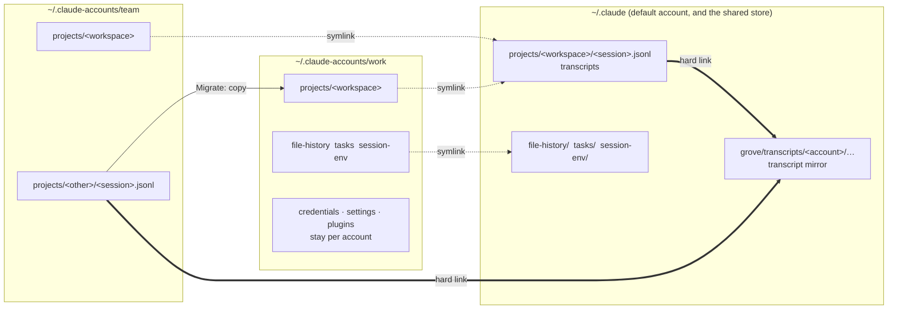

# Grove — git-worktree workspaces for parallel Claude Code sessions

[](https://github.com/efim0v/grove/actions/workflows/ci.yml)
[](https://github.com/efim0v/grove/releases/latest)
[](LICENSE)
[](#requirements)

A macOS menu-bar app for running [Claude Code](https://claude.com/claude-code) and other AI coding agents on a product that is split across several repositories.

Grove gives every feature its own **workspace**: one directory holding a git worktree of each repository. Claude Code starts in that directory and sees one consistent branch of the whole product, so parallel agent sessions never trip over each other's branches. Claude Code's own `--worktree` does this inside a single repository; [here is how the two differ](#why-not-claude-codes-built-in-worktrees). Grove also moves a session from one Claude account to another when a rate limit runs out.

**[Download Grove for macOS](https://github.com/efim0v/grove/releases/latest/download/Grove.zip)** or `brew install --cask efim0v/tap/grove` · macOS 26 or later, Apple silicon · [install notes](#install)

> **Companion app: [Brow](https://github.com/efim0v/brow).** Brow lives in the MacBook notch and shows the rate limits of every Claude account you have. Grove moves work between accounts; Brow tells you which account has room. Each runs on its own, and they are built to be used together.

<p align="center">
  
  <a href="https://github.com/efim0v/brow"></a>
</p>

All screenshots show made-up demo data.

## The problem

Claude Code works best when it can see the whole product in one directory. A monorepo gives it that. But many products are split across repositories — a client, a server, the server's configuration, an admin panel, a landing page, a handful of microservices — and merging millions of lines into one repository just for the agent is not always sensible, if only because of who should have access to what.

Run several agents in parallel on a multi-repo project and they start tripping over branches: one checks out a branch in the server repository, and another agent working on a different feature is suddenly looking at the wrong code.

## Workspaces

Grove's answer is the **workspace**: an umbrella directory for one feature or epic that contains a git worktree of each repository you chose, all on the same branch.

```
~/Workspaces/acme-shop/checkout-redesign/      <- start Claude Code here
├── web-client/     worktree on feat/checkout-redesign
├── api-server/     worktree on feat/checkout-redesign
└── server-config/  worktree on feat/checkout-redesign
```

Claude Code is launched in the umbrella directory. It gets what is in effect a private copy of the whole project on that feature's branch, and nothing another session does can change the branch under it. Ten features in flight are ten directories.

Creating one takes a name and a click: Grove runs `git worktree add` in each repository, applies your branch template, seeds shared files such as `CLAUDE.md`, and runs post-create hooks. Workspaces can be stacked — forked from another workspace rather than from the base branch — and Grove derives that tree from git itself.

<p align="center">
  
  
</p>

## Moving a session between accounts

The second thing Grove is for. A project does not have to stay on the account it started on: when one account runs out of limit, continue the same session on another.

- **Resume as…** continues a session under a different account without copying anything.
- **Migrate to…** makes a full copy of a session in another account — transcript, memory, file history, tasks — and works even while that account is in use.
- **Share** moves a session into the shared store so every linked account can see it.

Each project has a default account, and every launch can pick its own account, model and effort.

<p align="center">
  
  
</p>

## Graph and statistics

- **Graph** — the commit graph of a repository with its branches, remotes and tags. From a branch you can create a workspace or open Claude Code in its worktree.
- **Stats** — lines of code across the project: totals, language breakdown, and growth over time stacked by repository.

<p align="center">
  
  
</p>

There is also a command-line tool, `grove`, with `scan`, `workspaces`, `sessions`, `create`, `graph` and `doctor`, each with `--json`. `grove --version` prints its version, and `grove doctor` exits with status 1 when it can't run git or `claude`.

## Why not Claude Code's built-in worktrees?

Claude Code has worktrees of its own. `claude --worktree <name>` starts a session in a new worktree of the repository you run it in (by default under `.claude/worktrees/<name>/`, on a branch named `worktree-<name>`) and cleans the worktree up when you exit, asking first if there is work in it. Subagents and sessions in the desktop app can get worktrees too ([Claude Code docs](https://code.claude.com/docs/en/worktrees)). If your product lives in one repository, that may be all you need.

Grove is for a product split across repositories:

- **One branch across all of them.** A workspace holds a worktree of each repository you pick, all on the same branch, under one directory. Claude Code starts there and sees the whole product.
- **Your branch names and start points.** Branches follow your template, `feat/{name}` by default. Each repository can start from its own base branch, and a workspace can fork from another workspace's branches.
- **Set up on creation.** Shared files you choose, such as `CLAUDE.md`, are linked or copied into each new workspace, and each repository can run its own post-create hook.
- **Sessions across accounts.** Grove lists the sessions of every Claude account it knows and moves them between accounts with **Resume as…**, **Migrate to…** and **Share**.

## How Grove and Brow fit together

Claude Code keeps each account in its own directory: `~/.claude` for the default account and, here, `~/.claude-accounts/<name>` for the others. Both apps read those directories; neither talks to the other directly.



**The shared store (symbolic links).** There is no separate neutral directory: the default account's own `~/.claude` is the shared store. When an account is linked — by a button on the Accounts screen, or the first time you resume a session as another account — its `file-history`, `tasks` and `session-env` directories become symbolic links into `~/.claude`, and so does `projects/<workspace>` for each workspace involved. From then on a session started under one linked account is visible to the others, which is what makes **Resume as…** work without copying. Credentials, settings and plugins are never shared.

**The transcript mirror (hard links).** Separately, Grove keeps a safety copy of every transcript under `~/.claude/grove/transcripts/`. Each entry is a hard link to the live file, so it costs no extra disk space while the original exists. If a transcript disappears from an account, whether you deleted it or Claude Code's retention cleanup did, the next pass restores it. Entries are kept for 90 days and up to 500 MB by default; **Settings → Transcript safety-net** changes both limits or turns the mirror off, and **Purge** on the Sessions screen is the way to delete a transcript for good.

**Migration (copy).** **Migrate to…** copies a session's data from one account directory into another.

The other contracts between the two apps — the account key that names Keychain items and browser profiles, the browser router Grove borrows from an installed Brow, the status-line captures both read — are described in [`docs/grove-and-brow.md`](docs/grove-and-brow.md).

## What Grove does on your machine

Worth knowing before you run it:

- **Grove edits each account's `settings.json`**, pointing `statusLine.command` at its own wrapper so it can read usage per session. It does this at launch. The wrapper passes the same input on to the command you had, so your own status line keeps working, and **Stop** on the Accounts screen puts your command back.
- **Linking an account moves its session files into `~/.claude`.** Anything that would be overwritten is backed up under `<account>/grove-backup/` first.
- **The transcript mirror outlasts Claude Code's own cleanup.** Claude Code deletes transcripts older than [`cleanupPeriodDays`](https://code.claude.com/docs/en/settings-reference#cleanupperioddays): 30 days, unless you or your organization's managed settings set another value. The mirror holds a hard link to each transcript, so its content survives that deletion, and Grove restores the file on its next pass until the transcript is more than 90 days old (the default). A transcript you delete by hand comes back the same way. **Purge** on the Sessions screen deletes one for good. To leave retention to Claude Code, turn off **Keep a backup of every session** in Settings → Transcript safety-net, then delete `~/.claude/grove/transcripts/`.
- **Grove marks Claude Code's first-run setup as done** in account folders other than `~/.claude`: before it starts Claude Code in one, it sets `hasCompletedOnboarding` in that folder's `.claude.json` (and copies your theme if the folder has none), so the session doesn't open the onboarding wizard.
- **Grove does not read Claude Code's credentials.** Rate limits and sign-in are Brow's job.

[Uninstall](#uninstall) shows how to reverse the status-line, link and mirror changes.

This is an independent tool, not affiliated with or endorsed by Anthropic.

## Requirements

- macOS 26 or later.
- Xcode with Swift 6.2, to build.
- [Claude Code](https://claude.com/claude-code) and git.
- A terminal for the sessions: [cmux](https://cmux.dev), recommended, or Terminal.app. See below.
- For cross-account resume and the transcript mirror: an account signed in at the default `~/.claude`.
- Optional: [Brow](https://github.com/efim0v/brow), for per-account rate limits and for opening each account's sign-in in its own browser profile. When Brow is installed, Grove passes its browser router to every session it launches.

**cmux or Terminal.app.** Grove is built around cmux: it opens each session in a cmux workspace of its own and takes you to a running session in one click. Terminal.app works too, through the launch sheet, which opens for **New Claude** on a workspace, for the gear on a closed session, and when you click a closed session on the Projects screen. Set **Open in** to **Terminal** there; the sheet starts on cmux each time, and it also picks the account, model and effort. Every other button that starts or resumes a session (**Resume**, **Resume as…**, **Add & log in** and the rest) opens it in cmux. Grove can bring a session running in Terminal.app to the front when you click it on the Projects screen, but it can't launch into or switch to other terminals. A workspace is an ordinary directory, though, so you can start Claude Code in it from any terminal yourself.

## Install

With [Homebrew](https://brew.sh):

```sh
brew install --cask efim0v/tap/grove    # the menu-bar app
brew install efim0v/tap/grove-cli       # the grove command-line tool, if you want it
```

Or download **[Grove.zip](https://github.com/efim0v/grove/releases/latest/download/Grove.zip)** from the [latest release](https://github.com/efim0v/grove/releases/latest), unzip it and move `Grove.app` to `/Applications`. The release also has `grove-cli.zip`, the command-line tool, and `SHA256SUMS.txt`; check the downloads with `shasum -a 256 -c --ignore-missing SHA256SUMS.txt`.

Either way, the build is signed ad hoc and is not notarized by Apple, so macOS blocks the first launch. Open **System Settings → Privacy & Security**, find the message about Grove and press **Open Anyway** — or clear the quarantine flag yourself:

```sh
xattr -dr com.apple.quarantine /Applications/Grove.app
```

The `grove` tool from `grove-cli.zip` carries the same flag when you download it in a browser: `xattr -d com.apple.quarantine grove`.

First run: click the tree icon in the menu bar, open Settings, press **Add project…** and pick the directory that contains your repositories. Workspaces are created under `~/Workspaces/<project>/<name>` unless you change the template.

## Uninstall

Deleting `Grove.app` leaves its changes to your Claude Code folders in place. To undo them as well:

1. **Give each account its status line back.** On the **Accounts** screen press **Stop** next to *monitoring* on every account. Grove puts back the `statusLine` command it saved, or removes the key if there was none. Then check that no `settings.json` still points at Grove's wrapper:

   ```sh
   find ~/.claude ~/.claude-accounts -maxdepth 2 -name settings.json -exec grep -l grove-statusline {} +
   ```

   For each file it lists, open the script that file's `statusLine.command` names: its `GROVE_ORIG` line holds the command you had before. Put that command back, or delete the `statusLine` key if `GROVE_ORIG` is empty.

2. **Quit Grove** (**Quit** in the panel) and remove it: `brew uninstall --cask grove` and `brew uninstall grove-cli`, or move `Grove.app` and the `grove` tool to the Trash.

3. **Delete the files Grove created:**
   - `~/.claude/grove/`: the transcript mirror (`transcripts/`) and the default account's status-line captures (`usage/`). The transcripts in each account's `projects/` stay, but a transcript that only the mirror still holds goes with it.
   - `grove/` in every other account folder, such as `~/.claude-accounts/work/grove/`: that account's status-line captures.
   - `grove-backup/` in an account folder: what linking set aside. Look through it before you delete it.
   - `~/Library/Application Support/Grove/`: `config.json`, the wrapper scripts in `bin/` and the code statistics in `stats/`. If you keep using Brow, leave `oauth-usage-ledger.json`, which is Brow's. `defaults delete dev.artemefimov.grove3` removes Grove's preferences.

4. **Unlink accounts, if you want to.** A linked account's `file-history`, `tasks` and `session-env`, and `projects/<workspace>` for each shared workspace, are symbolic links into `~/.claude`, and they keep working without Grove. To give an account its own copies again, run this while no Claude Code session is using that account:

   ```sh
   cd ~/.claude-accounts/work    # the account's folder
   find file-history tasks session-env projects -maxdepth 1 -type l | while read -r link; do
     target=$(readlink "$link")
     rm "$link" && cp -R "$target" "$link"
   done
   ```

Workspaces are ordinary git worktrees and branches in your repositories, so they stay. To remove one, run `git worktree remove` on each of its worktrees, then delete its directory.

## Build

```sh
git clone https://github.com/efim0v/grove.git
cd grove

swift test                 # full suite, about two minutes
Scripts/build-app.sh       # -> dist/Grove.app
cp -R dist/Grove.app /Applications/
```

The app is signed ad hoc by default. macOS then forgets the Automation permission on every rebuild; to keep it, set `GROVE_SIGN_IDENTITY` to your own `Apple Development: Name (TEAMID)` identity before building.

The command-line tool:

```sh
swift build -c release
.build/release/grove --help
.build/release/grove workspaces ~/code/acme-shop
```

If cmux reports as unavailable, see [`docs/troubleshooting.md`](docs/troubleshooting.md).

## Layout

| Path | What it is |
|---|---|
| `Sources/GroveCore` | The core library: git and worktrees, cmux, Claude sessions, the shared store, the transcript mirror, migration, code statistics, credentials and usage. Brow depends on it too. |
| `Sources/GroveAppKit`, `Sources/GroveApp` | The menu-bar app |
| `Sources/grove-cli` | The `grove` command-line tool |
| `Tests` | About 920 tests |
| `docs` | How Grove and Brow fit together, snapshot testing, troubleshooting |

There are no third-party dependencies.

## Development

- `swift test` and `swift test -c release` should both stay green.
- `swift run GroveApp --snapshot /tmp/grove-snap` renders the app's screens to PNG without starting it; see [`docs/snapshot-testing.md`](docs/snapshot-testing.md).
- The screenshots in this README are regenerated with
  `DEMO_SCREENSHOTS_DIR="$PWD/docs/screenshots" swift test --filter DemoScreenshotTests`.
- Grove's configuration lives at `~/Library/Application Support/Grove/config.json`.

## License

[GNU GPL v3](LICENSE). Version 0.2.0 and earlier were released under the MIT License.
