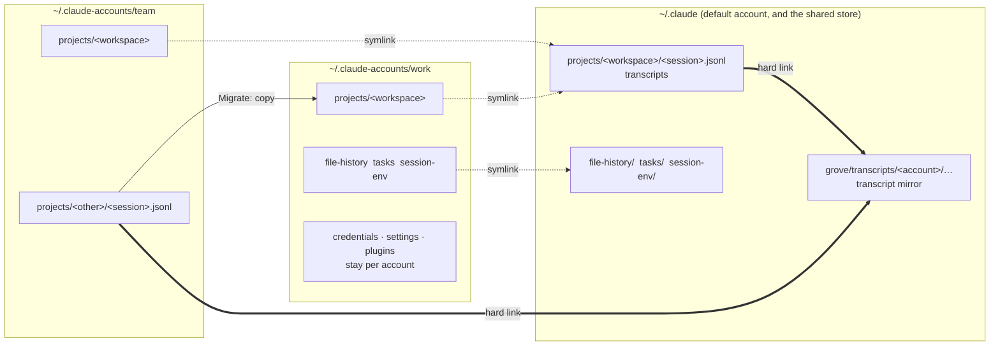

[English](README.md) · Русский · [简体中文](README.zh-CN.md)

Сайт: [efim0v.github.io/grove/ru](https://efim0v.github.io/grove/ru/)

> Это перевод [английского README](README.md). Английская версия основная и может быть новее перевода; если тексты расходятся, ориентируйтесь на неё.

# Grove — рабочие пространства на git worktree для параллельных сессий Claude Code

[](https://github.com/efim0v/grove/actions/workflows/ci.yml)
[](https://github.com/efim0v/grove/releases/latest)
[](LICENSE)
[](#требования)

Приложение в строке меню macOS для работы [Claude Code](https://claude.com/claude-code) и других ИИ-агентов над продуктом, код которого разнесён по нескольким репозиториям.

Grove выделяет каждой фиче своё **рабочее пространство** (workspace): один каталог, в котором лежит git worktree каждого репозитория. Claude Code запускается в этом каталоге и видит весь продукт на одной и той же ветке, поэтому параллельные сессии агентов никогда не мешают друг другу переключением веток. Встроенный в Claude Code флаг `--worktree` делает то же самое в пределах одного репозитория; [вот чем они отличаются](#почему-не-встроенные-worktree-claude-code). А ещё Grove переносит сессию с одного аккаунта Claude на другой, когда у первого кончается лимит.

**[Скачать Grove для macOS](https://github.com/efim0v/grove/releases/latest/download/Grove.zip)** или `brew install --cask efim0v/tap/grove` · macOS 26 или новее, Apple silicon · [подробнее об установке](#установка)

> **Приложение-компаньон: [Brow](https://github.com/efim0v/brow).** Brow живёт в чёлке MacBook и показывает лимиты всех ваших аккаунтов Claude. Grove переносит работу между аккаунтами, а Brow подсказывает, у какого аккаунта есть запас. Каждое приложение работает и само по себе, но задуманы они как пара.

<p align="center">
  
  <a href="https://github.com/efim0v/brow"></a>
</p>

На всех скриншотах — вымышленные демонстрационные данные.

## Проблема

Claude Code лучше всего работает, когда видит весь продукт в одном каталоге. Монорепозиторий это даёт. Но многие продукты разнесены по репозиториям — клиент, сервер, конфигурация сервера, админ-панель, лендинг, несколько микросервисов, — и сливать миллионы строк в один репозиторий только ради агента не всегда разумно, хотя бы из-за того, кому к чему положен доступ.

Стоит запустить параллельно несколько агентов на таком проекте, как они начинают спотыкаться о ветки: один переключает ветку в репозитории сервера — и второй агент, который делает другую фичу, вдруг видит не тот код.

## Рабочие пространства

Ответ Grove — **рабочее пространство**: общий каталог для одной фичи или эпика, в котором лежит git worktree каждого выбранного вами репозитория, и все они на одной ветке.

```
~/Workspaces/acme-shop/checkout-redesign/      <- start Claude Code here
├── web-client/     worktree on feat/checkout-redesign
├── api-server/     worktree on feat/checkout-redesign
└── server-config/  worktree on feat/checkout-redesign
```

Claude Code запускается в этом общем каталоге. По сути, он получает собственную копию всего проекта на ветке этой фичи, и ничто из того, что делает другая сессия, не может сменить ветку у него под ногами. Десять фич в работе — это десять каталогов.

Чтобы создать рабочее пространство, нужны только имя и один клик: Grove выполняет `git worktree add` в каждом репозитории, применяет ваш шаблон имени ветки, раскладывает общие файлы вроде `CLAUDE.md` и запускает хуки после создания. Рабочие пространства можно наслаивать — ответвлять от другого рабочего пространства, а не от базовой ветки, — и это дерево Grove строит по данным самого git.

<p align="center">
  
  
</p>

## Перенос сессии между аккаунтами

Вторая задача Grove. Проект не обязан оставаться на том аккаунте, с которого начался: когда у одного аккаунта кончается лимит, продолжайте ту же сессию на другом.

- **Resume as…** продолжает сессию под другим аккаунтом, ничего не копируя.
- **Migrate to…** делает полную копию сессии в другом аккаунте — транскрипт, память, историю файлов, задачи — и работает, даже если этот аккаунт сейчас используется.
- **Share** переносит сессию в общее хранилище, чтобы её видели все связанные аккаунты.

У каждого проекта есть аккаунт по умолчанию, а при каждом запуске можно отдельно выбрать аккаунт, модель и уровень effort.

<p align="center">
  
  
</p>

## Граф и статистика

- **Graph** — граф коммитов репозитория с ветками, удалёнными репозиториями и тегами. Из ветки можно создать рабочее пространство или открыть Claude Code в её worktree.
- **Stats** — строки кода по всему проекту: итоги, разбивка по языкам и рост во времени на диаграмме с накоплением по репозиториям.

<p align="center">
  
  
</p>

Есть и утилита командной строки `grove` с командами `scan`, `workspaces`, `sessions`, `create`, `graph` и `doctor`, и у каждой есть флаг `--json`. `grove --version` выводит версию утилиты, а `grove doctor` завершается с кодом 1, если не может запустить git или `claude`.

## Почему не встроенные worktree Claude Code?

У Claude Code есть собственные worktree. `claude --worktree <name>` запускает сессию в новом worktree того репозитория, где вы выполнили команду (по умолчанию в `.claude/worktrees/<name>/`, на ветке `worktree-<name>`), а при выходе убирает этот worktree, но сначала спрашивает, если в нём осталась работа. Worktree бывают и у субагентов, и у сессий в десктопном приложении ([документация Claude Code](https://code.claude.com/docs/en/worktrees)). Если ваш продукт живёт в одном репозитории, этого может быть вполне достаточно.

Grove нужен, когда продукт разнесён по нескольким репозиториям:

- **Одна ветка во всех репозиториях.** Рабочее пространство собирает в одном каталоге worktree каждого выбранного репозитория, и все они на одной ветке. Claude Code запускается там и видит весь продукт.
- **Ваши имена веток и точки старта.** Ветки называются по вашему шаблону, по умолчанию `feat/{name}`. Каждый репозиторий может стартовать со своей базовой ветки, а рабочее пространство — ответвиться от веток другого рабочего пространства.
- **Подготовка при создании.** Выбранные вами общие файлы, например `CLAUDE.md`, попадают в каждое новое рабочее пространство ссылкой или копией, а каждый репозиторий может запускать свой хук после создания.
- **Сессии в разных аккаунтах.** Grove показывает сессии всех известных ему аккаунтов Claude и переносит их между аккаунтами с помощью **Resume as…**, **Migrate to…** и **Share**.

## Как Grove и Brow работают вместе

Claude Code хранит каждый аккаунт в отдельном каталоге: `~/.claude` для аккаунта по умолчанию и, в этой схеме, `~/.claude-accounts/<name>` для остальных. Оба приложения читают эти каталоги, а напрямую друг с другом не общаются.



**Общее хранилище (символические ссылки).** Отдельного нейтрального каталога нет: общим хранилищем служит собственный `~/.claude` аккаунта по умолчанию. Когда аккаунт связывают — кнопкой на экране Accounts или при первом возобновлении сессии от имени другого аккаунта, — его каталоги `file-history`, `tasks` и `session-env` становятся символическими ссылками внутрь `~/.claude`, как и `projects/<workspace>` каждого затронутого рабочего пространства. С этого момента сессия, начатая под одним связанным аккаунтом, видна остальным, и именно поэтому **Resume as…** работает без копирования. Учётные данные, настройки и плагины никогда не становятся общими.

**Зеркало транскриптов (жёсткие ссылки).** Кроме того, Grove хранит страховочную копию каждого транскрипта в `~/.claude/grove/transcripts/`. Каждая запись — жёсткая ссылка на исходный файл, поэтому, пока оригинал существует, она не занимает лишнего места на диске. Если транскрипт пропал из аккаунта — вы ли его удалили или его стёрла очистка Claude Code по сроку хранения, — следующий проход его восстановит. По умолчанию записи хранятся 90 дней и занимают не больше 500 МБ; в **Settings → Transcript safety-net** можно изменить оба ограничения или выключить зеркало, а удалить транскрипт насовсем позволяет **Purge** на экране Sessions.

**Миграция (копирование).** **Migrate to…** копирует данные сессии из каталога одного аккаунта в каталог другого.

Остальные договорённости между приложениями — ключ аккаунта, по которому называются записи в связке ключей и профили браузера, браузерный роутер, который Grove берёт у установленного Brow, данные строки состояния, которые читают оба, — описаны в [`docs/grove-and-brow.md`](docs/grove-and-brow.md) (на английском).

## Что Grove делает на вашем Mac

Это стоит знать до первого запуска:

- **Grove меняет `settings.json` каждого аккаунта**: направляет `statusLine.command` на свою обёртку, чтобы видеть расход по каждой сессии. Делает он это при своём запуске. Обёртка передаёт те же входные данные вашей прежней команде, так что ваша строка состояния продолжает работать, а **Stop** на экране Accounts возвращает вашу команду на место.
- **При связывании аккаунта его файлы сессий переезжают в `~/.claude`.** Всё, что при этом было бы перезаписано, сначала сохраняется в `<account>/grove-backup/`.
- **Зеркало транскриптов переживает собственную очистку Claude Code.** Claude Code удаляет транскрипты старше [`cleanupPeriodDays`](https://code.claude.com/docs/en/settings-reference#cleanupperioddays): это 30 дней, если вы или управляемые настройки вашей организации не задали другое значение. Зеркало держит жёсткую ссылку на каждый транскрипт, поэтому его содержимое переживает такое удаление, и Grove восстанавливает файл при следующем проходе, пока транскрипт не станет старше 90 дней (значение по умолчанию). Транскрипт, удалённый вручную, возвращается так же. Насовсем его удаляет **Purge** на экране Sessions. Чтобы оставить хранение на усмотрение Claude Code, выключите **Keep a backup of every session** в Settings → Transcript safety-net, а затем удалите `~/.claude/grove/transcripts/`.
- **Grove отмечает первоначальную настройку Claude Code как пройденную** во всех папках аккаунтов, кроме `~/.claude`: прежде чем запустить в такой папке Claude Code, он выставляет `hasCompletedOnboarding` в её `.claude.json` (и копирует вашу тему, если в папке её нет), чтобы сессия не открывала мастер первого запуска.
- **Grove не читает учётные данные Claude Code.** Лимиты и вход в аккаунты — забота Brow.

Как откатить изменения строки состояния, связывания и зеркала, описано в разделе [Удаление](#удаление).

Это независимый инструмент. Anthropic не имеет к нему отношения и не одобряла его.

## Требования

- macOS 26 или новее.
- Для сборки — Xcode со Swift 6.2.
- [Claude Code](https://claude.com/claude-code) и git.
- Терминал для сессий: [cmux](https://cmux.dev) (рекомендуется) или Terminal.app. Подробнее ниже.
- Для возобновления сессий между аккаунтами и зеркала транскриптов — аккаунт, вход в который выполнен в стандартной папке `~/.claude`.
- Необязательно: [Brow](https://github.com/efim0v/brow) — чтобы видеть лимиты каждого аккаунта и входить в каждый аккаунт в его собственном профиле браузера. Если Brow установлен, Grove передаёт его браузерный роутер каждой сессии, которую запускает.

**cmux или Terminal.app.** Grove построен вокруг cmux: он открывает каждую сессию в отдельном рабочем пространстве cmux и в один клик переводит вас к запущенной сессии. Terminal.app тоже подходит — через окно запуска, которое открывается по кнопке **New Claude** у рабочего пространства, по шестерёнке у закрытой сессии и при клике на закрытую сессию на экране Projects. Выберите там в **Open in** вариант **Terminal**; окно каждый раз открывается с выбранным cmux, и в нём же выбираются аккаунт, модель и уровень effort. Все остальные кнопки, которые запускают или возобновляют сессию (**Resume**, **Resume as…**, **Add & log in** и прочие), открывают её в cmux. Grove может вывести на передний план сессию, запущенную в Terminal.app, когда вы кликаете по ней на экране Projects, но запускать сессии в других терминалах или переключаться на них он не умеет. Впрочем, рабочее пространство — обычный каталог, так что в нём можно самостоятельно запустить Claude Code из любого терминала.

## Установка

Через [Homebrew](https://brew.sh):

```sh
brew install --cask efim0v/tap/grove    # the menu-bar app
brew install efim0v/tap/grove-cli       # the grove command-line tool, if you want it
```

Или скачайте **[Grove.zip](https://github.com/efim0v/grove/releases/latest/download/Grove.zip)** из [последнего релиза](https://github.com/efim0v/grove/releases/latest), распакуйте и перенесите `Grove.app` в `/Applications`. В релизе также есть `grove-cli.zip` с утилитой командной строки и `SHA256SUMS.txt`; проверить скачанные файлы можно командой `shasum -a 256 -c --ignore-missing SHA256SUMS.txt`.

Каким бы способом вы ни установили Grove, сборка подписана ad hoc и не нотаризована Apple, поэтому macOS заблокирует первый запуск. Откройте **Системные настройки → Конфиденциальность и безопасность**, найдите сообщение о Grove и нажмите **Все равно открыть** — или снимите атрибут карантина сами:

```sh
xattr -dr com.apple.quarantine /Applications/Grove.app
```

Утилита `grove` из `grove-cli.zip` получает тот же атрибут, если скачать её через браузер: `xattr -d com.apple.quarantine grove`.

Первый запуск: нажмите на значок дерева в строке меню, откройте Settings, нажмите **Add project…** и выберите каталог, в котором лежат ваши репозитории. Рабочие пространства создаются в `~/Workspaces/<project>/<name>`, если вы не поменяете шаблон.

## Удаление

Если просто удалить `Grove.app`, его изменения в папках Claude Code останутся. Чтобы откатить и их:

1. **Верните каждому аккаунту его строку состояния.** На экране **Accounts** нажмите **Stop** рядом с *monitoring* у каждого аккаунта. Grove вернёт сохранённую команду `statusLine` или удалит ключ, если команды не было. Затем проверьте, что ни один `settings.json` больше не указывает на обёртку Grove:

   ```sh
   find ~/.claude ~/.claude-accounts -maxdepth 2 -name settings.json -exec grep -l grove-statusline {} +
   ```

   Для каждого найденного файла откройте скрипт, который указан в его `statusLine.command`: в строке `GROVE_ORIG` записана ваша прежняя команда. Верните эту команду на место или удалите ключ `statusLine`, если `GROVE_ORIG` пуст.

2. **Закройте Grove** (**Quit** в панели) и удалите его: `brew uninstall --cask grove` и `brew uninstall grove-cli` или перенесите `Grove.app` и утилиту `grove` в корзину.

3. **Удалите файлы, которые создал Grove:**
   - `~/.claude/grove/`: зеркало транскриптов (`transcripts/`) и данные строки состояния аккаунта по умолчанию (`usage/`). Транскрипты в `projects/` каждого аккаунта останутся, но транскрипт, который сохранился только в зеркале, исчезнет вместе с ним.
   - `grove/` в папке каждого другого аккаунта, например `~/.claude-accounts/work/grove/`: данные строки состояния этого аккаунта.
   - `grove-backup/` в папке аккаунта: то, что Grove отложил при связывании. Просмотрите содержимое, прежде чем удалять.
   - `~/Library/Application Support/Grove/`: `config.json`, скрипты-обёртки в `bin/` и статистика кода в `stats/`. Если продолжаете пользоваться Brow, оставьте `oauth-usage-ledger.json` — это файл Brow. Команда `defaults delete dev.artemefimov.grove3` удаляет настройки Grove.

4. **При желании отвяжите аккаунты.** У связанного аккаунта `file-history`, `tasks` и `session-env`, а также `projects/<workspace>` каждого общего рабочего пространства — это символические ссылки внутрь `~/.claude`, и без Grove они продолжают работать. Чтобы у аккаунта снова были собственные копии, выполните следующее, пока этот аккаунт не использует ни одна сессия Claude Code; вместо `~/.claude-accounts/work` подставьте папку своего аккаунта:

   ```sh
   cd ~/.claude-accounts/work
   find file-history tasks session-env projects -maxdepth 1 -type l | while read -r link; do
     target=$(readlink "$link")
     rm "$link" && cp -R "$target" "$link"
   done
   ```

Рабочие пространства — это обычные git worktree и ветки в ваших репозиториях, поэтому они остаются на месте. Чтобы удалить рабочее пространство, выполните `git worktree remove` для каждого его worktree, а затем удалите его каталог.

## Сборка

```sh
git clone https://github.com/efim0v/grove.git
cd grove

swift test                 # full suite, about two minutes
Scripts/build-app.sh       # -> dist/Grove.app
cp -R dist/Grove.app /Applications/
```

По умолчанию приложение подписывается ad hoc, и тогда macOS забывает разрешение на автоматизацию после каждой пересборки. Чтобы оно сохранялось, перед сборкой укажите в `GROVE_SIGN_IDENTITY` свой сертификат подписи `Apple Development: Name (TEAMID)`.

Утилита командной строки:

```sh
swift build -c release
.build/release/grove --help
.build/release/grove workspaces ~/code/acme-shop
```

Если cmux значится недоступным, см. [`docs/troubleshooting.md`](docs/troubleshooting.md) (на английском).

## Структура репозитория

| Путь | Что это |
|---|---|
| `Sources/GroveCore` | Основная библиотека: git и worktree, cmux, сессии Claude, общее хранилище, зеркало транскриптов, миграция, статистика кода, учётные данные и расход. От неё зависит и Brow. |
| `Sources/GroveAppKit`, `Sources/GroveApp` | Приложение для строки меню |
| `Sources/grove-cli` | Утилита командной строки `grove` |
| `Tests` | Около 920 тестов |
| `docs` | Как Grove и Brow работают вместе, снапшот-тестирование, решение проблем (на английском) |

Сторонних зависимостей нет.

## Разработка

- `swift test` и `swift test -c release` должны оставаться зелёными.
- `swift run GroveApp --snapshot /tmp/grove-snap` рендерит экраны приложения в PNG, не запуская его; см. [`docs/snapshot-testing.md`](docs/snapshot-testing.md) (на английском).
- Скриншоты в этом README пересоздаются командой
  `DEMO_SCREENSHOTS_DIR="$PWD/docs/screenshots" swift test --filter DemoScreenshotTests`.
- Конфигурация Grove хранится в `~/Library/Application Support/Grove/config.json`.

## Лицензия

[GNU GPL v3](LICENSE). Версия 0.2.0 и более ранние выходили под лицензией MIT.
