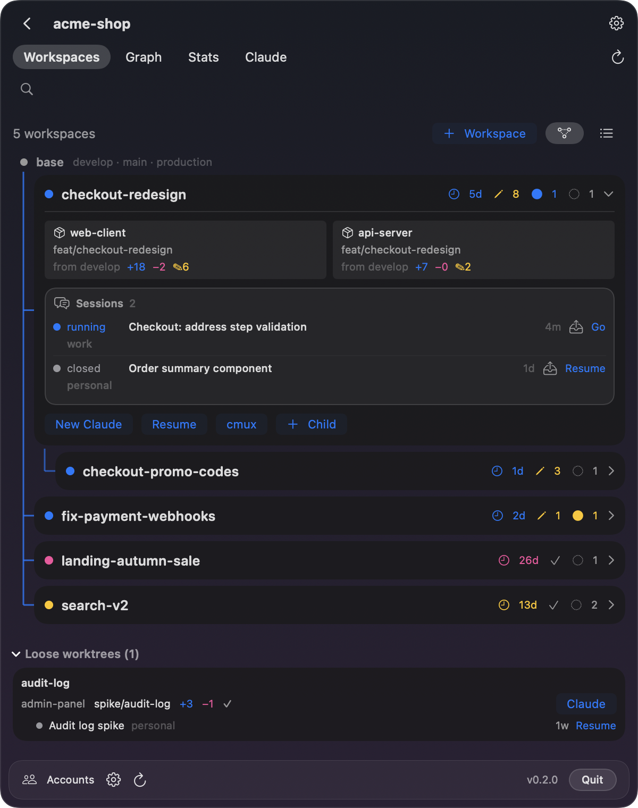
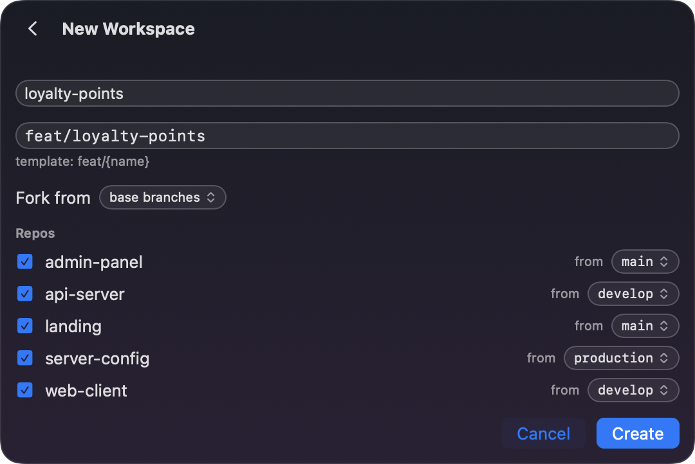
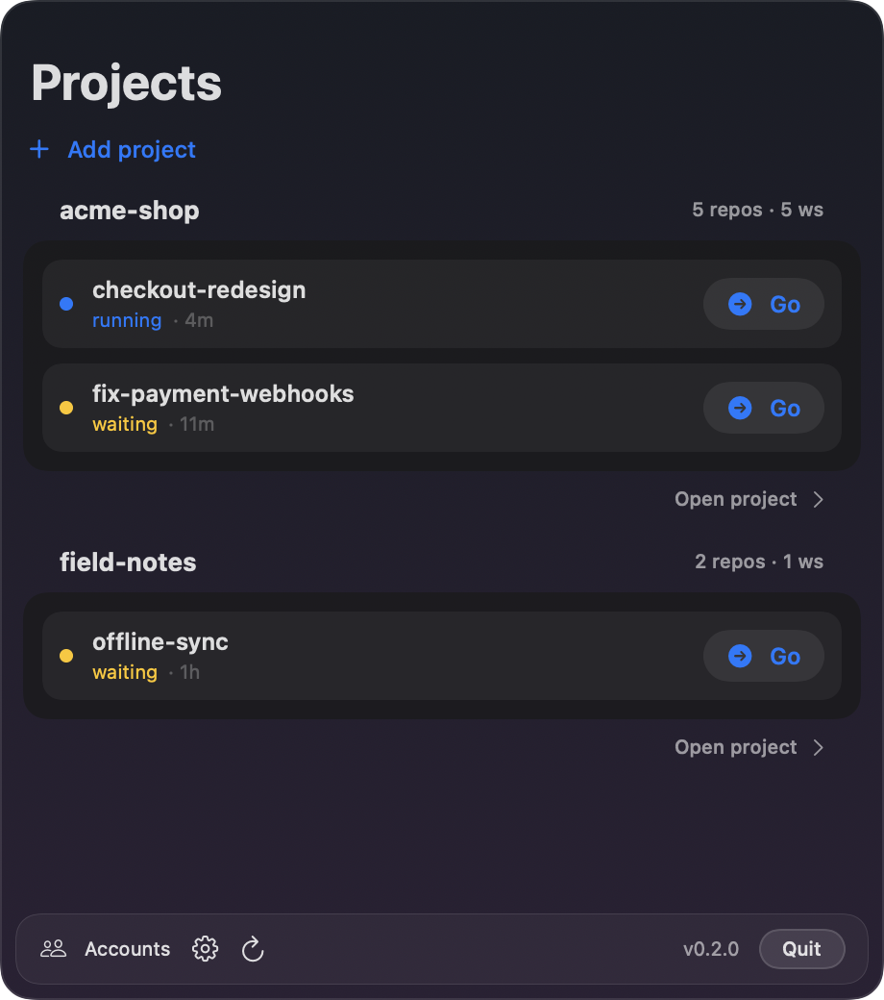
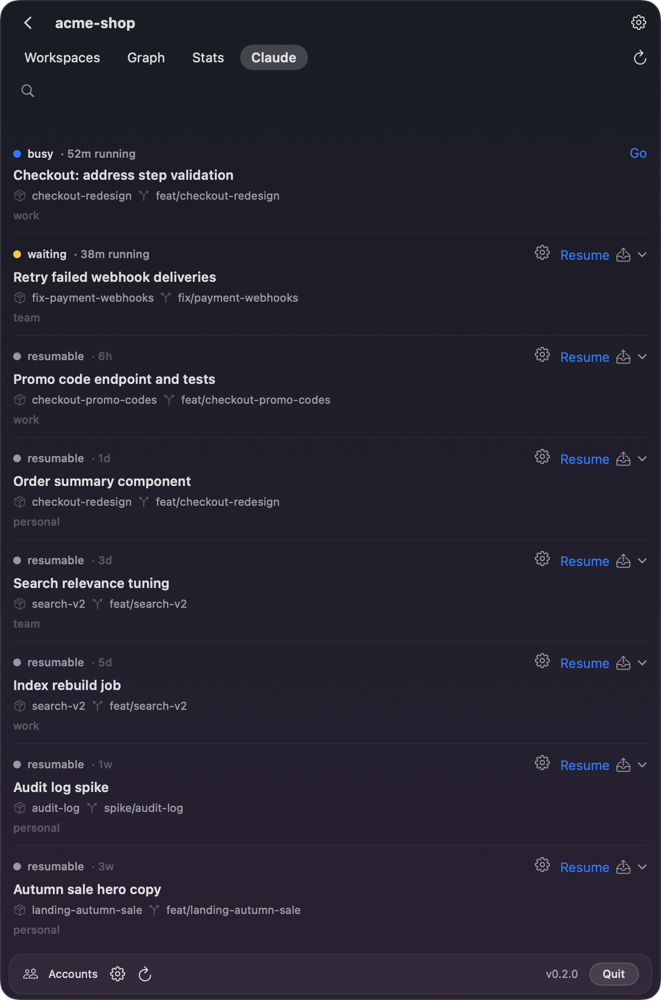
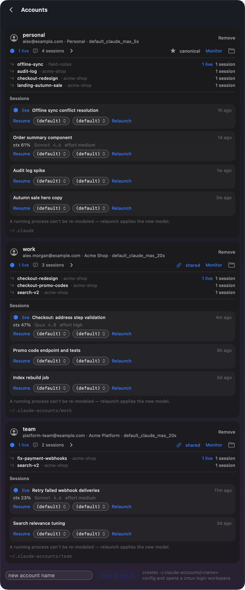
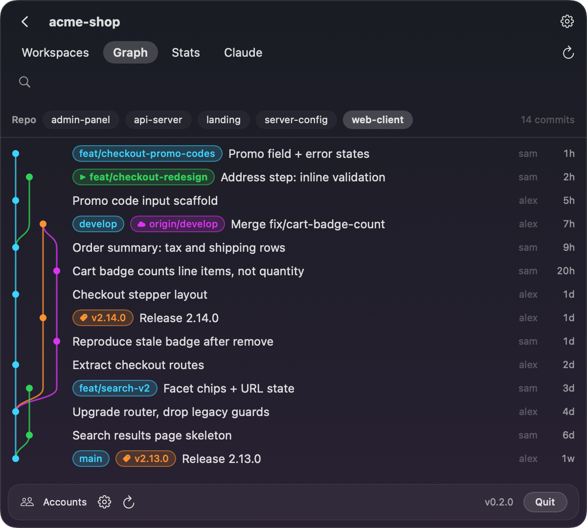
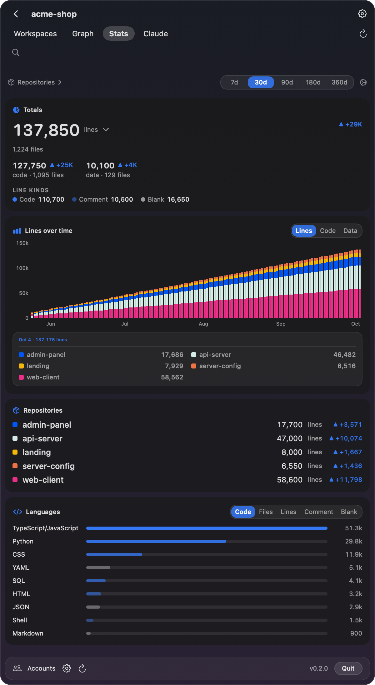
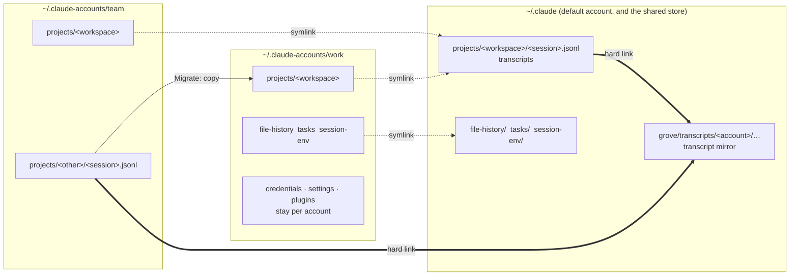

[English](README.md) · [Русский](README.ru.md) · 简体中文

> 本文是[英文 README](README.md) 的译文。英文版可能比译文更新，两者不一致时以英文版为准。

# Grove：面向并行 Claude Code 会话的 git worktree 工作区

[](https://github.com/efim0v/grove/actions/workflows/ci.yml)
[](https://github.com/efim0v/grove/releases/latest)
[](LICENSE)
[](#系统要求)

一款 macOS 菜单栏应用，用来在拆分为多个仓库的产品上运行 [Claude Code](https://claude.com/claude-code) 及其他 AI 编程智能体。

Grove 为每个功能提供独立的**工作区**（workspace）：一个目录，里面放着每个仓库的 git worktree。Claude Code 在这个目录中启动，看到的整个产品都处于同一个分支，因此并行的智能体会话永远不会在分支上互相干扰。Claude Code 自带的 `--worktree` 只在单个仓库内做到这一点，[两者的区别见下文](#为什么不用-claude-code-自带的-worktree)。此外，当一个 Claude 账号的限额用完时，Grove 还能把会话转到另一个账号上继续。

**[下载 macOS 版 Grove](https://github.com/efim0v/grove/releases/latest/download/Grove.zip)** 或 `brew install --cask efim0v/tap/grove` · macOS 26 或更高版本，Apple 芯片 · [安装说明](#安装)

> **配套应用：[Brow](https://github.com/efim0v/brow)**。Brow 常驻在 MacBook 的刘海里，显示你所有 Claude 账号的用量限额。Grove 负责在账号之间转移工作，Brow 告诉你哪个账号还有余量。两者都可以单独运行，同时也是专为搭配使用而设计的。

<p align="center">
  
  <a href="https://github.com/efim0v/brow"></a>
</p>

所有截图展示的都是虚构的演示数据。

## 问题所在

当 Claude Code 能在一个目录里看到整个产品时，它的效果最好。单体仓库（monorepo）天然做到了这一点。但很多产品拆分在多个仓库中——客户端、服务端、服务端配置、管理后台、落地页，再加上几个微服务——仅仅为了智能体就把数百万行代码合并进一个仓库，并不总是明智的，光是“谁该有权访问什么”就是个问题。

在多仓库项目上并行运行几个智能体，它们就会在分支上互相绊脚：一个智能体在服务端仓库里切换了分支，另一个正在开发别的功能的智能体看到的代码就突然不对了。

## 工作区

Grove 的答案是**工作区**：为一个功能或一个 epic 准备的外层目录，里面放着你选中的每个仓库的 git worktree，全部处于同一个分支。

```
~/Workspaces/acme-shop/checkout-redesign/      <- start Claude Code here
├── web-client/     worktree on feat/checkout-redesign
├── api-server/     worktree on feat/checkout-redesign
└── server-config/  worktree on feat/checkout-redesign
```

Claude Code 在这个外层目录中启动。它实际上得到了整个项目在该功能分支上的一份私有副本，其他会话无论做什么，都改变不了它脚下的分支。同时推进十个功能，就是十个目录。

创建工作区只需要一个名字和一次点击：Grove 会在每个仓库中运行 `git worktree add`，套用你的分支模板，放入 `CLAUDE.md` 等共享文件，并运行创建后钩子。工作区还可以叠加，即从另一个工作区而不是基础分支分叉出来；这棵树由 Grove 直接从 git 本身推导出来。

<p align="center">
  
  
</p>

## 在账号之间转移会话

这是 Grove 的第二个用途。项目不必一直留在最初使用的账号上：一个账号的限额用完了，就在另一个账号上继续同一个会话。

- **Resume as…** 以另一个账号继续会话，不复制任何内容。
- **Migrate to…** 把会话完整复制到另一个账号，包括会话记录、记忆、文件历史和任务，即使该账号正在使用中也可以。
- **Share** 把会话移入共享存储，让每个关联账号都能看到它。

每个项目都有一个默认账号，每次启动时也可以单独选择账号、模型和 effort 级别。

<p align="center">
  
  
</p>

## 提交图与统计

- **Graph**：仓库的提交图，包含分支、远程仓库和标签。可以从某个分支创建工作区，或在它的 worktree 中打开 Claude Code。
- **Stats**：整个项目的代码行数，包括总量、语言分布，以及按仓库堆叠显示的历史增长。

<p align="center">
  
  
</p>

另外还有命令行工具 `grove`，提供 `scan`、`workspaces`、`sessions`、`create`、`graph` 和 `doctor` 命令，每个命令都支持 `--json`。`grove --version` 会打印版本号；`grove doctor` 在无法运行 git 或 `claude` 时以退出码 1 退出。

## 为什么不用 Claude Code 自带的 worktree？

Claude Code 有自己的 worktree 功能。`claude --worktree <name>` 会在你运行它的仓库中新建一个 worktree 并在其中启动会话（默认位于 `.claude/worktrees/<name>/`，分支名为 `worktree-<name>`），退出时清理这个 worktree；如果里面还有工作，会先询问你。子代理和桌面应用中的会话也可以使用 worktree（[Claude Code 文档](https://code.claude.com/docs/en/worktrees)）。如果你的产品只有一个仓库，这可能就够用了。

Grove 面向拆分在多个仓库中的产品：

- **所有仓库共用一个分支**。工作区在同一个目录下放着你选中的每个仓库的 worktree，全部处于同一个分支。Claude Code 在那里启动，看到的是整个产品。
- **自己定的分支名和起点**。分支名遵循你的模板，默认是 `feat/{name}`。每个仓库都可以从自己的基础分支开始，工作区也可以从另一个工作区的分支分叉。
- **创建时自动准备**。你选定的共享文件（例如 `CLAUDE.md`）会以链接或副本的形式放进每个新工作区，每个仓库还可以运行自己的创建后钩子。
- **跨账号的会话**。Grove 列出它所知道的每个 Claude 账号的会话，并通过 **Resume as…**、**Migrate to…** 和 **Share** 在账号之间转移它们。

## Grove 与 Brow 如何配合

Claude Code 把每个账号放在各自的目录中：默认账号是 `~/.claude`，其他账号在这套约定中是 `~/.claude-accounts/<name>`。两个应用都读取这些目录，彼此之间并不直接通信。



**共享存储（符号链接）**。没有单独的中立目录：默认账号自己的 `~/.claude` 就是共享存储。账号被关联时（通过 Accounts 界面上的按钮，或在你第一次以另一个账号恢复会话时），它的 `file-history`、`tasks` 和 `session-env` 目录会变成指向 `~/.claude` 内部的符号链接，所涉及的每个工作区的 `projects/<workspace>` 也是如此。从此以后，在一个关联账号下启动的会话，其他关联账号都能看到，**Resume as…** 正是因此无需复制就能工作。凭据、设置和插件永远不会共享。

**会话记录镜像（硬链接）**。此外，Grove 会在 `~/.claude/grove/transcripts/` 下为每份会话记录保留一份安全副本。每个条目都是指向原文件的硬链接，因此只要原文件还在，就不额外占用磁盘空间。如果某个账号中的会话记录不见了，无论是你删的，还是 Claude Code 的保留期清理删的，下一轮检查都会把它恢复。条目默认保留 90 天，总量上限 500 MB；在 **Settings → Transcript safety-net** 中可以修改这两项限制或关闭镜像，要彻底删除一份会话记录，请使用 Sessions 界面上的 **Purge**。

**迁移（复制）**。**Migrate to…** 会把会话数据从一个账号目录复制到另一个账号目录。

两个应用之间的其他约定——用来命名钥匙串项目和浏览器配置文件的账号键、Grove 从已安装的 Brow 借用的浏览器路由脚本，以及两者都会读取的状态行数据——见 [`docs/grove-and-brow.md`](docs/grove-and-brow.md)（英文）。

## Grove 会在你的 Mac 上做什么

运行之前值得了解：

- **Grove 会修改每个账号的 `settings.json`**，把 `statusLine.command` 指向它自己的包装脚本，以便读取每个会话的用量。这一步在 Grove 启动时进行。包装脚本会把同样的输入转交给你原来的命令，所以你自己的状态行照常工作；在 Accounts 界面点击 **Stop** 即可恢复你的命令。
- **关联账号会把它的会话文件移到 `~/.claude`**。所有会被覆盖的内容都会先备份到 `<account>/grove-backup/`。
- **会话记录镜像比 Claude Code 自己的清理保留得更久**。Claude Code 会删除早于 [`cleanupPeriodDays`](https://code.claude.com/docs/en/settings-reference#cleanupperioddays) 的会话记录：即 30 天，除非你或你所在组织的托管设置指定了其他值。镜像为每份会话记录保留一个硬链接，因此其内容在这次删除后仍然存在；在会话记录超过 90 天（默认值）之前，Grove 都会在下一轮检查时把文件恢复。你手动删除的会话记录也会以同样的方式回来。要彻底删除一份，请使用 Sessions 界面上的 **Purge**。若想把保留策略交还给 Claude Code，请在 Settings → Transcript safety-net 中关闭 **Keep a backup of every session**，然后删除 `~/.claude/grove/transcripts/`。
- **在 `~/.claude` 以外的账号文件夹中，Grove 会把 Claude Code 的首次运行设置标记为已完成**：在这样的文件夹中启动 Claude Code 之前，它会在该文件夹的 `.claude.json` 里设置 `hasCompletedOnboarding`（如果该文件夹还没有主题，还会复制你的主题），这样会话就不会打开新手引导向导。
- **Grove 不读取 Claude Code 的凭据**。限额和登录是 Brow 的工作。

[卸载](#卸载)一节说明了如何撤销状态行、账号关联和镜像方面的改动。

这是一个独立工具，与 Anthropic 没有关联，也未获得 Anthropic 的认可。

## 系统要求

- macOS 26 或更高版本。
- 构建需要带 Swift 6.2 的 Xcode。
- [Claude Code](https://claude.com/claude-code) 和 git。
- 运行会话的终端：推荐 [cmux](https://cmux.dev)，也可以用 Terminal.app。详见下文。
- 跨账号恢复会话和会话记录镜像：需要在默认的 `~/.claude` 中登录一个账号。
- 可选：[Brow](https://github.com/efim0v/brow)，用来查看每个账号的限额，并在每个账号自己的浏览器配置文件中打开登录页面。安装了 Brow 时，Grove 会把 Brow 的浏览器路由脚本传给它启动的每个会话。

**cmux 或 Terminal.app**。Grove 是围绕 cmux 构建的：它把每个会话放在单独的 cmux 工作区中打开，点一下就能跳到正在运行的会话。Terminal.app 也能用，但要通过启动面板：在工作区上点击 **New Claude**、点击已关闭会话上的齿轮，或在 Projects 界面点击一个已关闭的会话时，都会打开这个面板。在面板中把 **Open in** 设为 **Terminal**；面板每次打开时默认选的是 cmux，账号、模型和 effort 级别也在这里选择。其他所有启动或恢复会话的按钮（**Resume**、**Resume as…**、**Add & log in** 等）都会在 cmux 中打开会话。在 Projects 界面点击一个正在 Terminal.app 中运行的会话时，Grove 能把它调到前台，但无法在其他终端中启动会话，也无法切换到其他终端。不过工作区只是一个普通目录，你可以自己在任何终端里进入它并启动 Claude Code。

## 安装

使用 [Homebrew](https://brew.sh)：

```sh
brew install --cask efim0v/tap/grove    # the menu-bar app
brew install efim0v/tap/grove-cli       # the grove command-line tool, if you want it
```

或者从[最新版本](https://github.com/efim0v/grove/releases/latest)下载 **[Grove.zip](https://github.com/efim0v/grove/releases/latest/download/Grove.zip)**，解压后把 `Grove.app` 移到 `/Applications`。发布页上还有命令行工具 `grove-cli.zip` 和 `SHA256SUMS.txt`；可以用 `shasum -a 256 -c --ignore-missing SHA256SUMS.txt` 校验下载的文件。

无论用哪种方式安装，这个构建都只做了 ad hoc 签名，没有经过 Apple 公证，所以 macOS 会阻止首次启动。打开**系统设置 → 隐私与安全性**，找到关于 Grove 的提示，点击**仍要打开**；或者自己清除隔离标记：

```sh
xattr -dr com.apple.quarantine /Applications/Grove.app
```

通过浏览器下载时，`grove-cli.zip` 里的 `grove` 工具也会带上同样的标记：`xattr -d com.apple.quarantine grove`。

首次运行：点击菜单栏中的树形图标，打开 Settings，点击 **Add project…**，然后选择存放你的各个仓库的目录。除非你修改模板，工作区都会创建在 `~/Workspaces/<project>/<name>` 下。

## 卸载

删除 `Grove.app` 并不会撤销它对 Claude Code 文件夹所做的改动。要连这些改动一起撤销：

1. **把状态行还给每个账号**。在 **Accounts** 界面上，对每个账号点击 *monitoring* 旁边的 **Stop**。Grove 会放回它保存的 `statusLine` 命令；如果原来没有，就删除这个键。然后确认没有任何 `settings.json` 仍指向 Grove 的包装脚本：

   ```sh
   find ~/.claude ~/.claude-accounts -maxdepth 2 -name settings.json -exec grep -l grove-statusline {} +
   ```

   对列出的每个文件，打开其 `statusLine.command` 所指向的脚本：其中 `GROVE_ORIG` 一行保存着你之前的命令。把这条命令放回去；如果 `GROVE_ORIG` 为空，就删除 `statusLine` 键。

2. **退出 Grove**（面板中的 **Quit**）并删除它：运行 `brew uninstall --cask grove` 和 `brew uninstall grove-cli`，或者把 `Grove.app` 和 `grove` 工具移到废纸篓。

3. **删除 Grove 创建的文件**：
   - `~/.claude/grove/`：会话记录镜像（`transcripts/`）和默认账号的状态行数据（`usage/`）。各账号 `projects/` 中的会话记录会保留，但只存在于镜像中的会话记录会随之一起删除。
   - 其他每个账号文件夹中的 `grove/`，例如 `~/.claude-accounts/work/grove/`：该账号的状态行数据。
   - 账号文件夹中的 `grove-backup/`：关联时被挪开的内容。删除前请先看一遍。
   - `~/Library/Application Support/Grove/`：`config.json`、`bin/` 中的包装脚本，以及 `stats/` 中的代码统计。如果你还要继续用 Brow，请保留 `oauth-usage-ledger.json`，它属于 Brow。`defaults delete dev.artemefimov.grove3` 会删除 Grove 的偏好设置。

4. **如有需要，解除账号关联**。已关联账号的 `file-history`、`tasks`、`session-env`，以及每个共享工作区的 `projects/<workspace>`，都是指向 `~/.claude` 内部的符号链接，没有 Grove 也能继续使用。要让某个账号重新拥有自己的副本，请在没有任何 Claude Code 会话使用该账号时运行：

   ```sh
   cd ~/.claude-accounts/work    # the account's folder
   find file-history tasks session-env projects -maxdepth 1 -type l | while read -r link; do
     target=$(readlink "$link")
     rm "$link" && cp -R "$target" "$link"
   done
   ```

工作区就是你仓库里普通的 git worktree 和分支，所以会保留下来。要删除某个工作区，请对它的每个 worktree 运行 `git worktree remove`，然后删除它的目录。

## 构建

```sh
git clone https://github.com/efim0v/grove.git
cd grove

swift test                 # full suite, about two minutes
Scripts/build-app.sh       # -> dist/Grove.app
cp -R dist/Grove.app /Applications/
```

应用默认使用 ad hoc 签名。这样一来，每次重新构建后 macOS 都会忘记“自动化”权限；要保留它，请在构建前把 `GROVE_SIGN_IDENTITY` 设为你自己的 `Apple Development: Name (TEAMID)` 签名身份。

命令行工具：

```sh
swift build -c release
.build/release/grove --help
.build/release/grove workspaces ~/code/acme-shop
```

如果 cmux 显示为不可用，请参阅 [`docs/troubleshooting.md`](docs/troubleshooting.md)（英文）。

## 目录结构

| 路径 | 内容 |
|---|---|
| `Sources/GroveCore` | 核心库：git 与 worktree、cmux、Claude 会话、共享存储、会话记录镜像、迁移、代码统计、凭据与用量。Brow 也依赖它。 |
| `Sources/GroveAppKit`、`Sources/GroveApp` | 菜单栏应用 |
| `Sources/grove-cli` | `grove` 命令行工具 |
| `Tests` | 约 920 个测试 |
| `docs` | Grove 与 Brow 如何配合、快照测试、故障排除（英文） |

没有第三方依赖。

## 开发

- `swift test` 和 `swift test -c release` 都应保持通过。
- `swift run GroveApp --snapshot /tmp/grove-snap` 无需启动应用即可把各个界面渲染为 PNG；参见 [`docs/snapshot-testing.md`](docs/snapshot-testing.md)（英文）。
- 本 README 中的截图可用以下命令重新生成：
  `DEMO_SCREENSHOTS_DIR="$PWD/docs/screenshots" swift test --filter DemoScreenshotTests`。
- Grove 的配置位于 `~/Library/Application Support/Grove/config.json`。

## 许可证

[GNU GPL v3](LICENSE)。0.2.0 及更早的版本以 MIT 许可证发布。
