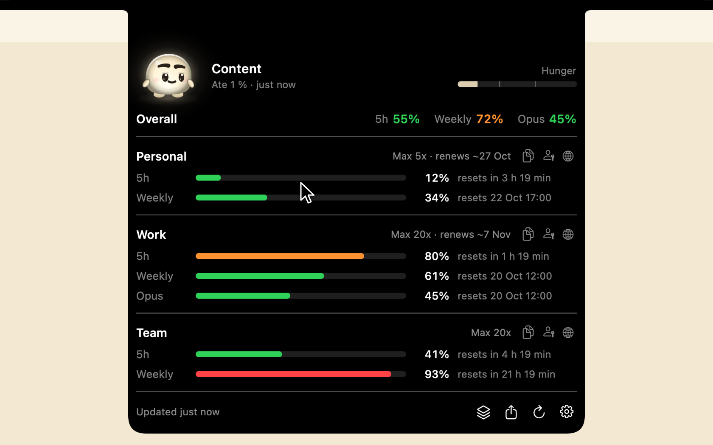
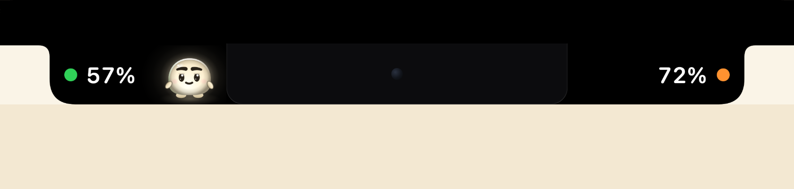
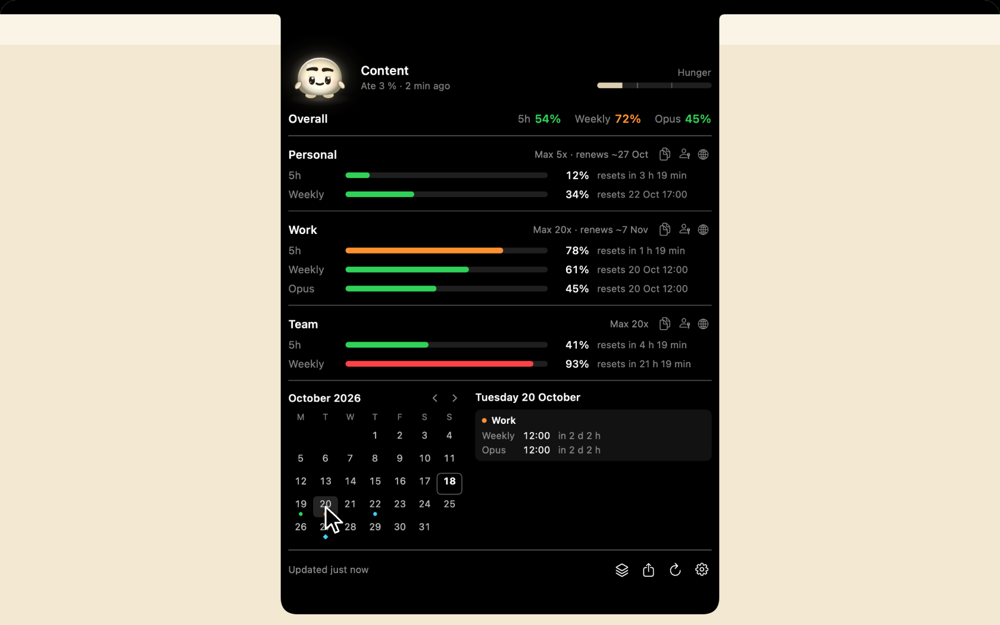
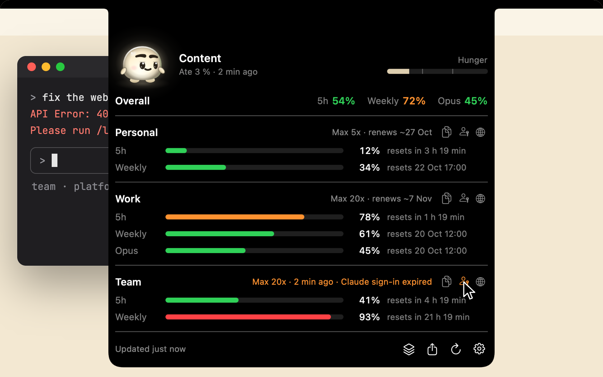
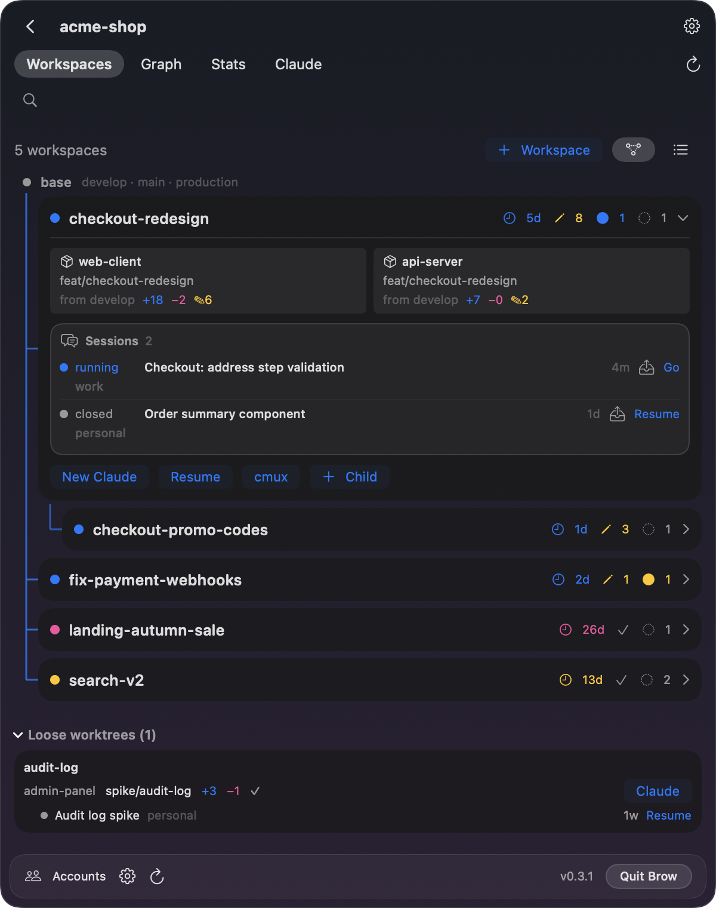
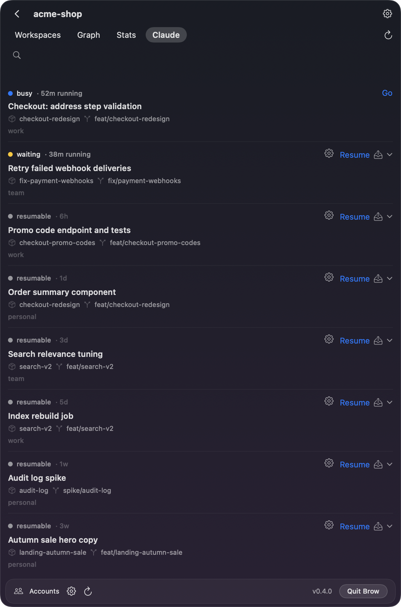
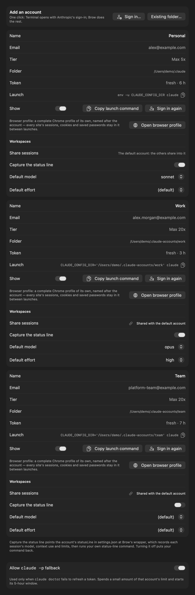

[English](README.md) · [Русский](README.ru.md) · 简体中文

网站：[efimov.page/brow/zh-cn](https://efimov.page/brow/zh-cn/)

> 本文是[英文 README](README.md) 的译文。英文版可能比译文更新，两者不一致时以英文版为准。

# Brow：MacBook 刘海里的 Claude Code 用量限额，以及用于并行会话的工作区

[](https://github.com/efim0v/brow/actions/workflows/ci.yml)
[](https://github.com/efim0v/brow/releases/latest)
[](LICENSE)
[](#系统要求)

一款 macOS 应用，面向同时用多个账号运行 [Claude Code](https://claude.com/claude-code) 的人。它做两件事：

- **刘海显示每个账号的用量和限额**：5 小时限额、每周限额，以及各自的重置时间。只需点一下，就能在专属于某个账号的浏览器配置文件中登录这个账号。
- **菜单栏里的 Workspaces 在拆分为多个仓库的产品上运行并行的 Claude Code 会话**：每个功能一个文件夹，里面是所有仓库在同一分支上的 git worktree；会话可以转移到仍有余量的账号上。

刘海用来看，Workspaces 用来干活。只有一个账号也能用：Brow 会自动找到 `~/.claude` 并显示该账号的限额，而在你使用之前，Workspaces 一直处于关闭状态。

**[下载 macOS 版 Brow](https://github.com/efim0v/brow/releases/latest/download/Brow.zip)** 或 `brew install --cask efim0v/tap/brow` · macOS 26 或更高版本，Apple 芯片 · [安装说明](#安装)

> **用过 Grove？** Grove 现在是 Brow 的一部分。Brow 会找到你在 Grove 中的项目和账号，并在 Workspaces 中运行它们；[有哪些变化](#从-grove-迁移)。

### 哪个账号还有余量

将指针悬停在刘海上，所有账号的 5 小时限额和每周限额就会从刘海中展开。复制某个账号的启动命令，Claude Code 就会以该账号的身份启动。

<p align="center"><picture>
  <source media="(prefers-reduced-motion: reduce)" srcset="docs/media/brow-hero-v2.png">
  <source type="image/webp" srcset="docs/media/brow-hero-v2.webp">
  
</picture></p>

### Glim：一只吃限额的宠物

一个小家伙住在 5 小时限额的数字旁边。数字每上涨一次，它就咬一口；它身上的光就是它的饥饿程度。5 小时限额用完时，它吃饱睡着；每周限额用完时，它躲进摄像头后面的窝里，等重置后再出来。在 Settings → General → **Show the pet** 中可以关闭。

<p align="center"><picture>
  <source media="(prefers-reduced-motion: reduce)" srcset="docs/media/brow-glim-v1.png">
  <source type="image/webp" srcset="docs/media/brow-glim-v1.webp">
  
</picture></p>

### 每个限额何时重置

日历标出每个账号的每周重置日和订阅续费日。指向某一天，就能看到那天会恢复什么。

<p align="center"><picture>
  <source media="(prefers-reduced-motion: reduce)" srcset="docs/media/brow-calendar-v2.png">
  <source type="image/webp" srcset="docs/media/brow-calendar-v2.webp">
  
</picture></p>

### 一键重新登录

某个账号的登录过期后，点击它旁边的钥匙，就会为该账号运行 `claude auth login`，并打开属于它的浏览器配置文件，其中已经登录了这个账号。其他账号的登录状态不受影响。

<p align="center"><picture>
  <source media="(prefers-reduced-motion: reduce)" srcset="docs/media/brow-signin-v2.png">
  <source type="image/webp" srcset="docs/media/brow-signin-v2.webp">
  
</picture></p>

### 所有仓库同一个分支

Workspaces 为多仓库产品的每个功能单独建一个文件夹，里面是每个仓库在同一分支上的 git worktree。Claude Code 在这个文件夹里启动，能看到整个产品；同时进行的十个功能就是十个文件夹，任何会话都无法切换另一个会话脚下的分支。

<p align="center">
  
  
</p>

所有演示和截图均使用虚构数据。

## 功能

刘海里：

- **所有账号一目了然**：每个账号显示 5 小时限额、每周限额，以及特定模型的每周限额（如有），均以已用百分比表示，并附上距离各自重置还剩多久。
- **重置日历**：在月历上标出每周重置日和预计的订阅续费日，哪个账号什么时候恢复，一看便知。
- **限额预警**：默认关闭。开启后，账号用到某项限额的 80% 和 95% 时，Brow 会发出 macOS 通知；每个阈值在限额重置前只提醒一次。
- **Glim，一只吃限额的宠物**：一个小家伙住在刘海旁边，你的账号用掉什么，它就吃什么：5 小时限额的数字一上涨，它就咬一口。你在 Mac 前好几个小时都没用 Claude Code，它就会饿；你不在的时候，它从不变饿。5 小时限额用完时，它吃饱睡着，直到窗口重置；每周限额用完时，它冬眠到每周重置。默认开启；在 Settings → General → **Show the pet** 中可以关闭。
- **复制“我的一周”**：一个按钮可以把各账号的限额复制成一张图片，直接粘贴到聊天或帖子里。除非你选择显示名称，图片上的账号只显示编号，也不会出现邮箱。
- **复制启动命令**：一个按钮即可复制以该账号身份启动 Claude Code 的命令。
- **在账号自己的浏览器里重新登录**：每个账号都有独立的浏览器配置文件，Cookie、历史记录和已保存的登录信息互不相通，登录一个账号绝不会影响另一个。第二个按钮可以直接打开这个配置文件。
- **一键添加账号**：Brow 会创建账号文件夹，并打开 Anthropic 自己的登录流程。
- **令牌保持有效**：空闲账号的令牌会在后台刷新，所以数字不会过时。正在被 Claude Code 会话使用的账号交给该会话，由它自己刷新令牌。

Workspaces 里：

- **每个功能一个工作区**：一个文件夹，里面是你选中的每个仓库的 git worktree，全部位于按你的模板命名的同一分支上。`CLAUDE.md` 等共享文件会自动放进去，每个仓库可以运行自己的创建后钩子，一个工作区还可以从另一个工作区分出来。
- **跨账号的会话**：**Resume as…** 不复制任何东西，直接以另一个账号继续会话；**Migrate to…** 把会话完整复制过去，即使目标账号正在使用中也可以；**Share** 让所有已关联的账号都能看到它。每个账号选择器都会显示该账号的限额，名称与你在 Settings → Accounts 里给它起的名字一致。
- **每个会话最后说了什么，谁在和谁对话**：Projects 按状态和最后一轮对话显示每个会话，需要你处理的排在最前，并建议 Claude Code 正在运行的文件夹；**Agents** 实时画出你的会话、子智能体和智能体团队之间的消息往来。
- **提交图和统计**：每个仓库的提交图，以及整个项目随时间变化的代码行数。
- **命令行工具 `brow`**，包含 `scan`、`workspaces`、`sessions`、`create`、`graph` 和 `doctor` 命令，每个都支持 `--json`。

独立的浏览器配置文件需要 Google Chrome、Chromium、Brave 或 Edge。如果都没有，链接会在默认浏览器中打开，不做隔离。关于刘海的更多细节见 [`docs/brow.md`](docs/brow.md)，关于 Workspaces 见 [`docs/workspaces.md`](docs/workspaces.md)（均为英文）。

<p align="center">
  
</p>

收起时，Brow 在刘海两侧显示两个数字：你的所有账号总体上用掉了多少 5 小时限额和每周限额。指针悬停时，它会展开成上面演示中的面板。这两个读数也可以放到刘海下方的横条里：

<p align="center">
  
</p>

## Brow 会在你的 Mac 上做什么

运行之前，值得了解这些。刘海部分：

- **Brow 从 macOS 钥匙串读取 Claude Code 的登录令牌**，只用它调用 Anthropic 的用量（usage）和个人资料（profile）接口。这些接口并非有公开文档的 API，可能会发生变化。令牌不会写入磁盘，也不会记入日志，任何数据都不会发往别处。如果 macOS 不让 Brow 读取某个账号的令牌，该账号旁会显示一把钥匙；点击它，Brow 会向 macOS 申请访问权限。
- **Brow 会查看正在运行的 Claude Code 进程**：只在某个账号的令牌需要刷新或被 Anthropic 拒绝时查看，以免刷新正被会话使用的令牌。它读取 `claude`、node、bun 和 deno 进程的命令行，以判断哪些是 Claude Code，从它们的环境中只取 `CLAUDE_CONFIG_DIR`，另外还会读取每个账号最近一次保存提示词的时间（`history.jsonl`）。原因见[常见问题](#brow-会刷新-claude-code-正在使用的令牌吗)。
- **备用令牌刷新默认开启**。如果常规刷新失效，Brow 会运行一个很小的 `claude -p` 请求，这会消耗少量限额，并开启该账号的 5 小时窗口。可在 Settings → Accounts 中关闭；它具体何时运行，见[常见问题](#brow-会消耗我的限额吗)。
- **每个账号的浏览器配置文件都是一个单独的目录**，位于 `~/Library/Application Support/Brow/browser-profiles/` 下。Brow 会设置配置文件的名称，并在其中允许第三方 Cookie，以便登录正常进行。
- **登录时会打开“终端”**，在其中运行 `claude auth login`；macOS 会询问一次是否允许 Brow 控制“终端”。
- **Brow 会把 Claude Code 的首次设置标记为已完成**：在 `~/.claude` 以外的账号文件夹中启动 Claude Code 之前，它会在该文件夹的 `.claude.json` 中设置 `hasCompletedOnboarding`（如果那里没有主题，还会复制你的主题），这样会话就不会打开首次运行向导。
- **开启宠物后，Brow 会请 macOS 在每个账号的 `history.jsonl` 被写入时通知它**，好让宠物在你开始使用 Claude Code 时打起精神。Brow 从不读取这个文件。宠物自己的状态（它的饥饿程度、它看到的最近读数、它吃饱的日子）保存在 `~/Library/Application Support/Brow/pet.json` 中。

Workspaces 部分，只在你开启它之后（或 Brow 找到 Grove 的设置时）：

- **只有在 Settings → Accounts 中为某个账号开启 Capture the status line 后，它才会修改该账号的 `settings.json`**（Grove 已经在捕获的账号保持不变）。它会把 `statusLine.command` 指向 Brow 的包装脚本：脚本记录每个会话的模型、上下文用量和限额，然后把同样的输入交给你原来的命令，所以你自己的状态栏照常工作。关闭后会恢复你原来的命令。即使关闭 Workspaces，Claude Code 仍会继续运行这个包装脚本，所以在你关闭捕获之前，这个开关会一直留在 Settings → Accounts 中。
- **为账号开启会话共享会把它的会话文件移入 `~/.claude`**。任何会被覆盖的内容都会先备份到 `<账号>/grove-backup/` 下。
- **转录安全网默认关闭，除非你开启它**（Grove 的设置会保留）。开启后，Brow 会在 `~/.claude/grove/transcripts/` 下为每份转录保留一个硬链接。消失的转录会列在 Settings → Workspaces 中，只有在你点击 **Restore** 后才会恢复。任何转录的保存时间都不会超过 Claude Code 自己的保留期限：[`cleanupPeriodDays`](https://code.claude.com/docs/en/settings-reference#cleanupperioddays)，取你所在组织的托管设置、账号设置以及该账号的会话运行过的各个项目文件夹的项目设置中最短的一个（多个账号共享的工作区，取所有这些账号中最短的期限）；距期限结束不到一天的转录也不会提供恢复。Brow 唯一无法看到的，是通过 `--settings` 传给 `claude` 的期限。
- **它会在你的仓库中运行 git**：创建工作区时在每个仓库里执行 `git worktree add` 并创建分支，以及运行你配置的创建后钩子。它从不自行删除 worktree 或分支。
- **它会操控 cmux**：通过 cmux 的套接字（如果 cmux 需要，会使用 `~/.config/cmux/cmux.json` 中的密码），以及通过 AppleScript，macOS 会询问你一次是否允许。
- **只有在你要求时才使用 `--dangerously-skip-permissions`**，可以按项目或按单次启动设置。
- **它会查看 Claude Code 在哪些文件夹里运行，以及每个会话的对话停在了哪里。** 面板打开时，以及 Projects 列表可见期间每隔几秒，Brow 会读取 Claude Code 在每个账号的 `sessions/` 文件夹中保存的会话记录，并查看正在运行的 `claude` 进程：它们的命令行、工作文件夹，以及环境中的 `CLAUDE_CONFIG_DIR`（环境中只取这一项）。这样每个会话就有了状态，而 Claude 正在运行、但还不是项目的文件夹会作为建议列出。为了显示预览，它会读取会话转录的最后 64 KB：你最近的提示词和 Claude 最近的一行回复。Settings → Workspaces → **Show message previews** 可以关闭预览。这些内容都不会写入任何地方，也不会发往任何地方。
- **Agents 标签页会读取智能体互相发消息时 Claude Code 写下的内容**，只在面板打开期间以及关闭后的半分钟内：最近半小时内写入的转录、每个账号 `teams/` 下的智能体团队信箱，以及会话记录。每条消息只保留第一行，只存在内存中，最多保留一小时。它从不连接会话的套接字，从不打开会话记录旁边的收件密钥，也从不加入任何对话。

[卸载](#卸载)一节说明了如何撤销以上所有更改。

这是一个独立工具，与 Anthropic 没有关联，也未获 Anthropic 认可。

## 系统要求

- macOS 26 或更高版本；预编译版本仅支持 Apple 芯片。刘海布局为带刘海的 MacBook 设计；在其他显示器上，Brow 显示为一个胶囊。
- 构建需要带 Swift 6.4 或更高版本的 Xcode（Swift 6.2 无法编译 BrowKit）。
- [Claude Code](https://claude.com/claude-code)。
- 独立的浏览器配置文件需要 Chrome、Chromium、Brave 或 Edge。
- Workspaces 需要 git，以及运行会话的终端：推荐 [cmux](https://cmux.dev)，也可以用“终端”（[两者的区别](docs/workspaces.md#cmux-or-terminalapp)）。跨账号恢复会话和转录安全网需要一个登录在默认 `~/.claude` 中的账号。

## 安装

```sh
brew install --cask efim0v/tap/brow     # 应用
brew install efim0v/tap/brow-cli        # 命令行工具 brow（如果需要）
```

也可以从[最新版本](https://github.com/efim0v/brow/releases/latest)下载 **[Brow.zip](https://github.com/efim0v/brow/releases/latest/download/Brow.zip)**，解压后把 `Brow.app` 移到 `/Applications`。发布中还有命令行工具 `brow-cli.zip`（`grove` 是它的第二个名字）和 `SHA256SUMS.txt`：把下载的文件放在同一个文件夹里，运行 `shasum -a 256 -c --ignore-missing SHA256SUMS.txt` 即可校验。

该构建使用 ad hoc 签名，未经 Apple 公证，所以无论用哪种方式安装，macOS 都会拦下首次启动。打开**系统设置 → 隐私与安全性**，找到关于 Brow 的提示，点击**仍要打开**；也可以自己清除隔离属性：

```sh
xattr -dr com.apple.quarantine /Applications/Brow.app
```

在浏览器中下载的 `brow-cli.zip` 中的 `brow` 工具也带有同样的属性：`xattr -d com.apple.quarantine brow`。

如果 macOS 不让 Brow 读取某个账号的钥匙串项目，该账号会显示一把橙色钥匙，Settings → Accounts 中会把它的令牌标为 *Keychain access needed*：点击钥匙，或点击那里的 **Grant Keychain access**，然后选择**始终允许**。由于构建使用 ad hoc 签名，更新到新版本后，钥匙可能会再次出现。

Brow 没有程序坞图标：它待在刘海里，设置从面板上的 ⚙ 打开。在 Settings → General 中开启 **Launch at login**，即可在登录时自动启动 Brow。要开始使用 Workspaces，请打开 **Settings → Workspaces**，或者点击刘海面板上叠放方块的按钮，选择 **Add project…**。

## 从 Grove 迁移

从 0.4.0 起，Grove 的 Workspaces 引擎连同其历史成为 Brow 的一部分；[grove 仓库](https://github.com/efim0v/grove)会以只读形式保留，供旧版构建使用。

- **你的配置原样迁移**。Brow 会找到 `~/Library/Application Support/Grove/config.json`，并开启 Workspaces，带上你的项目、账号、已捕获的状态栏和安全网设置。没有任何文件被移动：状态栏包装脚本仍在 `Grove/bin` 中，每个已捕获账号的 `settings.json` 都指向那里。
- **刘海会读取每个账号，包括 Workspaces 的账号**。Grove 从不读取钥匙串，也不访问 Anthropic；刘海会这样做，对象是它找到的每个账号，包括 Workspaces 知道的那些。它从钥匙串读取账号的登录信息（如果 macOS 不让读取某个账号的钥匙串项目，该账号会显示一把橙色钥匙：点击它，然后选择**始终允许**），向 Anthropic 的用量接口查询限额，并用 `claude doctor` 让空闲账号的令牌保持有效。如果这样不行，它会改为运行一次单轮 `claude -p` 请求，这会消耗该账号少量限额，并开启它的 5 小时窗口；可在 Settings → Accounts → **Allow `claude -p` fallback** 中关闭。其余内容见 [Brow 会在你的 Mac 上做什么](#brow-会在你的-mac-上做什么)。
- **先退出 Grove.app**。它运行期间，Workspaces 会等待，并提供 **Quit Grove**，以免两者同时写同一批文件。然后删除 `Grove.app`（或运行 `brew uninstall --cask grove`）；如果你把它加入过登录项，请在那里移除，并改为在 Brow 中开启 **Launch at login**。
- **东西都去了哪里**。菜单栏里的树变成了 Brow 的标志：带两个点的刘海。面板的设置页移到了 **Settings → Workspaces**；添加账号、共享会话和捕获状态栏移到了 **Settings → Accounts**，在那里用 Brow 的一键 **Sign in…** 添加账号。各项目自己的设置仍在面板中。
- **命令行工具现在叫 `brow`**。`brow-cli.zip` 安装 `brow`，并以 `grove` 作为第二个名字，所以你的脚本无需修改即可继续使用。如果你通过 Homebrew 安装过 Grove 的命令行工具，请在 `brew install efim0v/tap/brow-cli` 之前先运行 `brew uninstall grove-cli`：两者都会安装 `grove`。
- **转录安全网不再自行恢复转录**。以前它会自行恢复任何不到 90 天的转录，包括被 Claude Code 自己的清理删除的转录。现在它不会保留超过 Claude Code 保留期限的转录，消失的转录会列在 Settings → Workspaces 中，并附有 **Restore** 按钮。因此，Grove 过去反复恢复的、早于 `cleanupPeriodDays`（未设置时为 30 天）的转录，会在 Claude Code 下次清理时被删除，安全网也会删掉它们的副本。如果想保留较早的会话，请在迁移之前调高每个账号 `settings.json` 中的 `cleanupPeriodDays`。

## 常见问题

### Brow 会消耗我的限额吗？

只有备用令牌刷新会消耗，而且可以关闭。读取限额是向 Anthropic 的用量接口发请求，而不是调用模型；空闲账号的令牌通过 `claude doctor` 保持有效，它也不会调用模型。

备用刷新默认开启。当某个账号的令牌剩余有效期不超过 30 分钟，而 `claude doctor` 没能续期时，Brow 会在该账号中用 Haiku 运行一次单轮 `claude -p` 请求。这会消耗该账号极少的限额，并开启它的 5 小时窗口。如果 Anthropic 已拒绝该令牌，或者 `claude doctor` 超时或无法启动，Brow 不会发出这个请求。对每个账号，它最多每 30 分钟运行一次；连续三次尝试都没有效果后，Brow 就不再对该账号使用这个办法。在 Settings → Accounts → **Allow `claude -p` fallback** 中可以将其关闭。

### Brow 会刷新 Claude Code 正在使用的令牌吗？

不会。Claude Code 用刷新令牌（refresh token）为令牌续期，而刷新令牌每次续期都会更换；两次续期几乎同时发生时，会话可能会拿着失效的令牌，并要求你运行 `/login`。因此，只要某个账号文件夹有正在运行的 `claude` 进程（未设置 `CLAUDE_CONFIG_DIR` 即对应 `~/.claude`），无论该会话空闲了多久，或者过去 15 分钟内在该账号中输入过提示词，Brow 都不会刷新这个账号的令牌，而是让会话自己续期。在此之前，Settings → Accounts 中该账号的令牌显示为 *in use by Claude Code, waiting for it to refresh*。如果令牌已经过期，面板会显示 *Token in use by Claude Code*，而不是让你重新登录；等你再次使用该会话或将其关闭后，数字就会恢复。

### Brow 从哪里读取令牌？会有数据离开我的 Mac 吗？

从 Claude Code 为每个账号保存的钥匙串项目中读取：`~/.claude` 对应 `Claude Code-credentials`，其他账号文件夹对应 `Claude Code-credentials-<hash>`。Brow 用 macOS 的 `security` 工具读取，不行时回退到钥匙串 API；对于较旧版本的 Claude Code，则改为读取账号文件夹中的 `.credentials.json`。它只使用访问令牌，续期交给 Claude Code 自己处理。

Brow 自己的网络请求只发往两个 Anthropic 接口，不会发往别处：`api.anthropic.com/api/oauth/usage` 用于获取用量数字；`api.anthropic.com/api/oauth/profile` 每个账号大约每天请求一次，用于估算日历中的续费日期。Brow 没有任何统计分析，也不检查更新。Workspaces 自己不发出任何网络请求；它运行的 `claude` 和 `git` 命令会建立它们平常就会建立的连接，各账号的浏览器配置文件会打开 claude.ai。

### Brow 支持哪些 Mac？显示在哪里？

macOS 26 或更高版本；预编译版本仅支持 Apple 芯片。Brow 位于主显示器顶部。如果主显示器有刘海，两个读数会显示在刘海两侧（默认），或者显示在刘海下方的横条里：Settings → General → **Ears**。在同一标签页中关闭 **Show readouts next to the notch** 后，指针移到刘海之前不会绘制任何内容。如果主显示器没有刘海（例如外接显示器），Brow 会改为在屏幕顶部中央显示一个胶囊；关闭读数后，指针移到屏幕顶部中央之前不会绘制任何内容。如果你只用 Brow 的 Workspaces，可以关闭 **Show Brow in the notch**，这样它不会在屏幕顶部绘制任何内容，限额提醒仍会照常发送。

### 宠物费电吗？

它只在屏幕亮着、你在 Mac 前时才绘制：静止时每秒 30 帧，进食或移动的一两秒内每秒 60 到 120 帧；屏幕锁定或休眠、你离开满十分钟，或者宠物已关闭时，一帧也不画。它遵循“减弱动态效果”（Reduce Motion）设置。

### 菜单栏里看不到 Brow 的图标。

在带刘海的 MacBook 上，macOS 会隐藏刘海旁放不下的菜单栏图标。这时 Workspaces 仍然可以通过刘海面板上叠放方块的按钮、Brow 菜单中的 **Show Workspaces**，以及从访达或聚焦搜索再次打开 Brow 来打开。Settings → General → **Show Workspaces in the menu bar** 可以完全关闭这个图标。

### 为什么不用 Claude Code 自带的 worktree？

`claude --worktree` 为单个会话在你运行它的仓库中创建一个 worktree，如果产品只有一个仓库，这可能就够了。Workspaces 面向拆分为多个仓库的产品：所有仓库同一分支、放在一个文件夹下，使用你自己的分支名和起点，创建时自动准备文件和钩子，会话还能在账号之间转移。[详细回答](docs/workspaces.md#why-not-claude-codes-built-in-worktrees)（英文）。

## 卸载

1. **如果用过 Workspaces，先把每个账号的状态栏还给它**：包装脚本位于第 4 步会删除的 Grove 文件夹中。在 Settings → Accounts 中，为每个显示该开关的账号关闭 **Capture the status line**；无论 Workspaces 是否开启，这个开关都在那里。如果 Grove 仍在运行，请先退出它。然后确认没有任何 `settings.json` 仍指向包装脚本：

   ```sh
   find ~/.claude ~/.claude-accounts -maxdepth 2 -name settings.json -exec grep -l grove-statusline {} +
   ```

   对列出的每个文件，打开其 `statusLine.command` 指向的脚本：其中的 `GROVE_ORIG` 一行保存着你原来的命令。把这条命令填回去；如果 `GROVE_ORIG` 为空，就删除 `statusLine` 键。
2. 如果开启过 **Launch at login**，先在 Settings → General 中关闭它。然后在 Brow 的设置窗口位于最前面时按 ⌘Q 退出 Brow，或者使用 Workspaces 面板中的 **Quit Brow**。
3. 删除应用：运行 `brew uninstall --cask efim0v/tap/brow` 和 `brew uninstall efim0v/tap/brow-cli`，或者把 `Brow.app` 和 `brow` 工具移到废纸篓。
4. 关闭 Brow 为各账号打开的浏览器窗口，然后删除 Brow 的文件：它的设置、缓存的读数、宠物的状态、各账号的浏览器配置文件（包括其中的 Cookie 和已保存的密码）、Workspaces 的文件夹（其配置、包装脚本、代码统计和请求节奏文件），以及 macOS 为 Brow 的网络请求保存的数据：

   ```sh
   rm -rf ~/Library/Application\ Support/Brow
   rm -rf ~/Library/Application\ Support/Grove
   rm -rf ~/Library/Caches/dev.artemefimov.brow ~/Library/HTTPStorages/dev.artemefimov.brow
   ```

   如果用过 Grove，运行 `defaults delete dev.artemefimov.grove3` 还会删除它的偏好设置。

5. 如果用过 Workspaces，删除它在各账号文件夹中保存的内容：`~/.claude/grove/`（转录安全网和默认账号的状态栏捕获数据；各账号 `projects/` 中的转录本身会保留），以及其他每个账号文件夹中的 `grove/`。删除 `grove-backup/` 文件夹（共享会话时预留的内容）之前，请先检查一遍。已共享账号的 `file-history`、`tasks` 和 `session-env`，以及每个共享工作区的 `projects/<工作区>`，都是指向 `~/.claude` 的符号链接，可以继续正常使用；详见 [`docs/workspaces.md`](docs/workspaces.md#how-accounts-share-sessions)（英文）。
6. 如果你把 Brow 的 `export BROWSER=…` 这一行加进了 `~/.zshrc`，请删除它。

如果你先删除了应用，而 Brow 仍然出现在“系统设置 → 通用 → 登录项与扩展”中，请在那里将它移除。`~/.claude-accounts` 下的账号文件夹属于 Claude Code，没有 Brow 也能照常使用。工作区就是你仓库中普通的 git worktree 和分支，所以会保留：要删除某个工作区，对它的每个 worktree 运行 `git worktree remove`，然后删除其文件夹。

## 构建

```sh
git clone https://github.com/efim0v/brow.git
cd brow

Scripts/test-in-empty-home.sh   # 运行全部测试，主目录指向一个空文件夹
Scripts/build-brow.sh           # -> dist/Brow.app 和 dist/brow
cp -R dist/Brow.app /Applications/
```

应用默认使用 ad hoc 签名。这样每次重新构建后，macOS 都会忘记钥匙串和自动化权限；要保留它们，请在构建前把 `BROW_SIGN_IDENTITY` 设置为你自己的 `Apple Development: Name (TEAMID)` 身份。

## 目录结构

| 路径 | 内容 |
|---|---|
| `Sources/GroveCore` | 账号、凭据、用量和令牌刷新；git、worktree、cmux、Claude Code 会话、共享存储、转录安全网、会话迁移、代码统计 |
| `Sources/GroveAppKit` | Workspaces 面板及其状态 |
| `Sources/BrowKit` | 刘海、限额、宠物、设置，以及 Brow 对 Workspaces 的承载 |
| `Sources/BrowApp` | 入口 |
| `Sources/brow-cli` | 命令行工具 `brow` |
| `Resources` | 应用图标、按账号区分的浏览器路由脚本、Info.plist 模板 |
| `Tests` | 约 1550 个测试 |
| `docs` | [刘海详解](docs/brow.md)、[Workspaces](docs/workspaces.md)、[架构](docs/architecture.md)、[故障排除](docs/troubleshooting.md)（均为英文） |

没有任何第三方依赖。模块名 `GroveCore` 和 `GroveAppKit` 来自 Grove，本仓库包含了它的历史。

## 开发

- `Scripts/test-in-empty-home.sh` 和 `Scripts/test-in-empty-home.sh -c release` 都应保持通过；`Scripts/check-warnings.sh` 不应发现新的警告。
- `swift run BrowApp --snapshot /tmp/brow-snap` 无需启动应用即可把 Workspaces 的各个界面渲染成 PNG；见 [`docs/snapshot-testing.md`](docs/snapshot-testing.md)。
- 本 README 中的截图用以下命令重新生成：
  `DEMO_SCREENSHOTS_DIR="$PWD/docs/screenshots" swift test --filter DemoScreenshotTests`。
- 刘海轮廓的调校常量位于 `Sources/BrowKit/Panel/NotchGeometry.swift`，需要对照实际的屏幕边框凭肉眼微调。

## 致谢

- [boring.notch](https://github.com/TheBoredTeam/boring.notch)（GPL-3.0）：刘海轮廓的常量，以及在独立的 SkyLight 空间中绘制、使面板在切换 Spaces 时保持不动的思路。
- [NotchNook](https://lo.cafe/notchnook)：同样让刘海面板在切换 Spaces 时保持不动的做法。
- [cmux](https://cmux.dev)：Workspaces 在其中打开会话的终端。
- [Grove](https://github.com/efim0v/grove)：0.4 之前 Brow 的配套应用，它的 Workspaces 引擎现在是 Brow 的一部分。

## 许可证

[GNU GPL v3](LICENSE)。Brow 与 Grove 的 0.2.0 及更早版本以 MIT 许可证发布。
