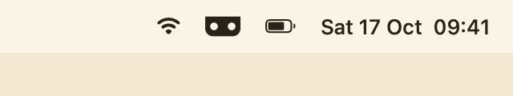
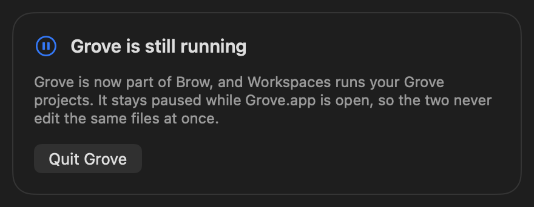
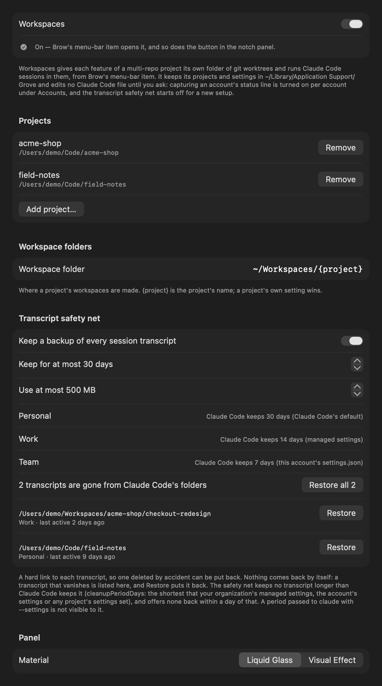
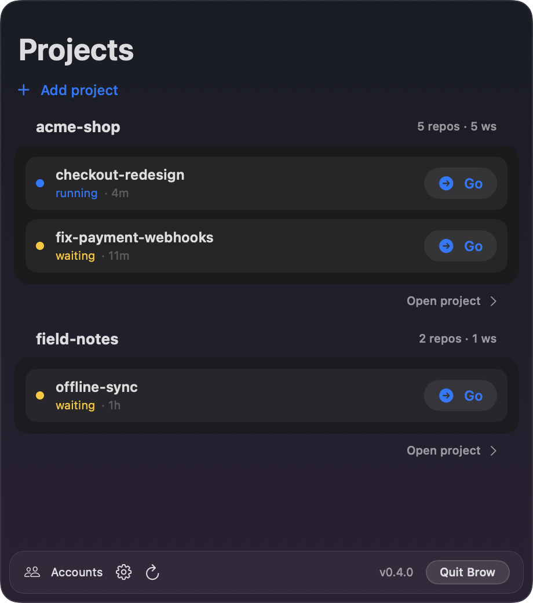
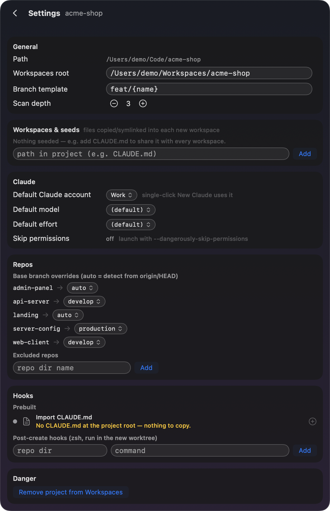
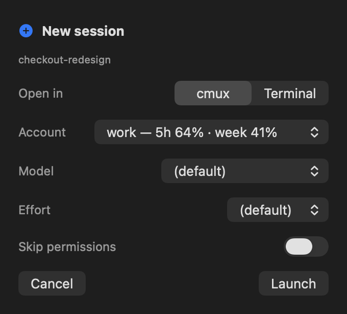
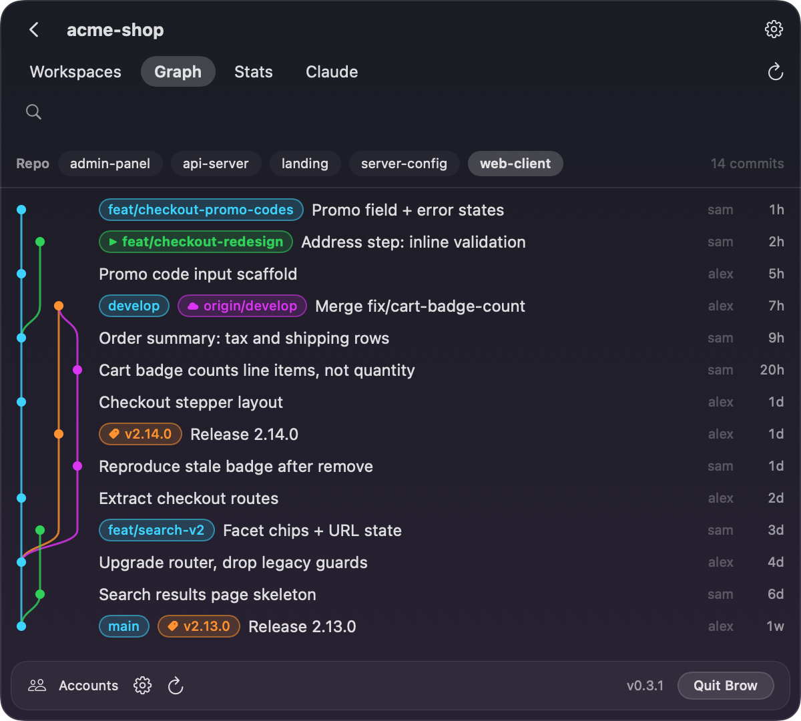
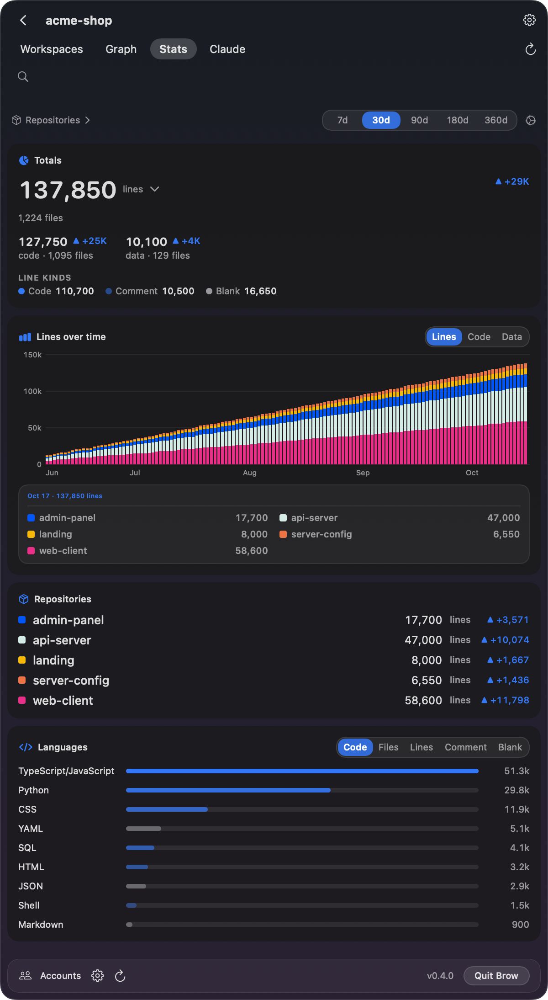
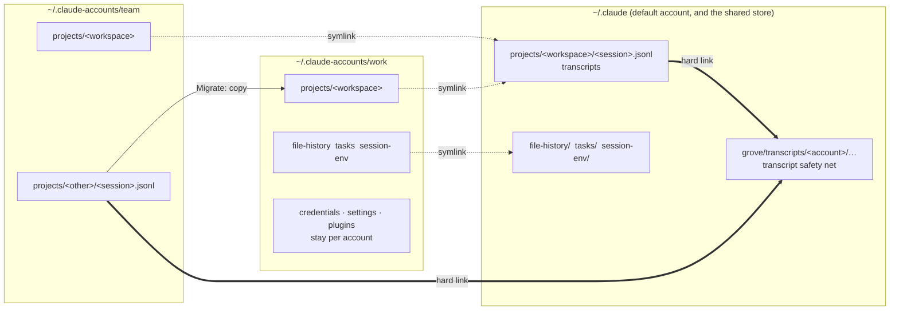

# Workspaces

Workspaces is the part of Brow for **running parallel Claude Code sessions on a product split across several repositories**. Until Brow 0.4 it was a separate app, [Grove](https://github.com/efim0v/grove); it is now part of Brow, with its history.

It is the **Projects** and **Agents** sides of the notch panel: while Workspaces is on, a switch at the top of the panel goes between **Limits**, **Projects** and **Agents**, in the same black under the notch. Brow's item in the menu bar (the notch with two dots), **Show Projects** in Brow's menu and opening Brow again open the panel on Projects, pinned. The limits tell you which account has room; Projects is where the work happens and where it moves to another account.

<p align="center">
  
</p>

- [Turning it on](#turning-it-on)
- [The problem](#the-problem)
- [Workspaces](#workspaces-1)
- [What runs and who talks to whom](#what-runs-and-who-talks-to-whom)
- [Moving a session between accounts](#moving-a-session-between-accounts)
- [Graph and statistics](#graph-and-statistics)
- [The command-line tool](#the-command-line-tool)
- [Why not Claude Code's built-in worktrees?](#why-not-claude-codes-built-in-worktrees)
- [How accounts share sessions](#how-accounts-share-sessions)
- [cmux or Terminal.app](#cmux-or-terminalapp)

## Turning it on

Workspaces is off until you use it. While it is off nothing of it runs, with one exception: an account whose status line it captured keeps going through Brow's wrapper, which records each session under `<account>/grove/usage/`, until you turn capture off for that account in Settings → Accounts. To offer that switch, Settings reads Grove's `config.json` when there is one; turning capture off puts your own command back in the account's `settings.json` and records the change in Grove's config. Workspaces touches no other Claude Code file while it is off.

- **Coming from Grove?** Brow finds Grove's `~/Library/Application Support/Grove/config.json` and turns Workspaces on by itself, with your projects, accounts and settings. While `Grove.app` is still running, Workspaces waits and offers **Quit Grove**: two copies of the engine would write the same files. Once Grove has quit you can delete it; take it out of **System Settings → General → Login Items** if you had added it there, and turn on **Launch at login** in Brow's Settings → General instead. Brow's notch then reads every account, Workspaces' included, which Grove never did, and Claude Code's clean-up removes the old transcripts Grove kept putting back: [Coming from Grove](../README.md#coming-from-grove) says what that means and how to keep them.
- **New to it?** Open **Settings → Workspaces** and turn it on. Projects then appears in the notch panel; **Add a folder…** there, or **+** beside its search, adds a project.

<p align="center">
  
</p>

Turning it on changes nothing in your Claude Code accounts by itself. Two things that do are separate choices:

- **Capture the status line**, per account, in Settings → Accounts. It points the account's `statusLine` at Brow's wrapper, which records each session's model, context use and limits and then runs your own status-line command. Turning it off puts your command back. Accounts Grove already captured stay captured.
- **The transcript safety net**, in Settings → Workspaces. It starts off for a new setup; a Grove setup keeps the setting it had.

<p align="center">
  
</p>

## The problem

Claude Code works best when it can see the whole product in one directory. A monorepo gives it that. But many products are split across repositories — a client, a server, the server's configuration, an admin panel, a landing page, a handful of microservices — and merging them into one repository just for the agent is not always sensible, if only because of who should have access to what.

Run several agents in parallel on a multi-repo project and they start tripping over branches: one checks out a branch in the server repository, and another agent working on a different feature is suddenly looking at the wrong code.

## Workspaces

The answer is the **workspace**: an umbrella directory for one feature or epic that contains a git worktree of each repository you chose, all on the same branch.

```
~/Workspaces/acme-shop/checkout-redesign/      <- start Claude Code here
├── web-client/     worktree on feat/checkout-redesign
├── api-server/     worktree on feat/checkout-redesign
└── server-config/  worktree on feat/checkout-redesign
```

Claude Code is launched in the umbrella directory. It gets what is in effect a private copy of the whole project on that feature's branch, and nothing another session does can change the branch under it. Ten features in flight are ten directories.

Creating one takes a name and a click: Brow runs `git worktree add` in each repository, applies your branch template, seeds shared files such as `CLAUDE.md`, and runs post-create hooks. Workspaces can be stacked — forked from another workspace rather than from the base branch — and Brow derives that tree from git itself.

<p align="center">
  
  
</p>

A project is the directory that holds your repositories. Its own settings — default account, model and effort, branch template, base branches, seed files, hooks, `--dangerously-skip-permissions` — are in the notch panel, under the gear next to the project. The settings that are not any one project's — the projects list, where workspaces are made, the safety net — are in Settings → Workspaces.

<p align="center">
  
  
</p>

## What runs and who talks to whom

**Projects** shows each session by the end of its conversation: its state — *Needs permission* or *Asks you* in yellow when it waits on you, *Working*, *Your turn*, *Closed* — where it runs and as which account, your newest prompt and Claude's newest line (*Wants to run* and the command, while it waits on a permission). What needs you comes first, then what works, then what waits; a project shows up to three sessions and "N more", and projects with nothing running take one line each. Nothing moves while the list is in view: a state changes in place, and the list is sorted again the next time the panel opens. The yellow number on the Projects switch counts the sessions that need you, whichever side is in front; on Limits, an account's "N live" chip opens Projects narrowed to that account.

Folders where Claude Code runs that are no project yet are suggested at the top, with **Add**, or ✕ for "not now", which is remembered. **Other folders** lists the sessions outside every project by the folder around them, each folder with **Add as project**. A session that needs you in a folder that is no project yet is counted on the switch like any other, so the list says where it is: on the suggested folder's row, else on the Other folders row. The search finds sessions by their prompts, replies, titles and folders, closed ones included.

How Brow knows: Claude Code keeps a small record for each running session in `<account>/sessions/<pid>.json`, its state included, and Brow asks the kernel whether that process still runs. For a session without a record it looks at the running `claude` processes — their command line, their working folder, and from their environment only `CLAUDE_CONFIG_DIR` — and gives each process one session, its newest in that folder. The previews come from the last 64 KB of each transcript, read again only when the file has changed. Settings → Workspaces → **Show message previews** shows titles instead, for sharing your screen.

**Agents** draws who talks to whom among the Claude Code agents on this Mac: sessions on a row, joined by arcs when they message each other, and each session's subagents and agent-team members in a short tree under it. A message is a small light that runs from the sender to the receiver; the pair stays warm and cools to grey over ten minutes. A message waiting for your approval waits at the receiver, yellow. When more sessions talk than the row holds, the ones quiet the longest fold into "+N more" at its corner ("+N quiet" when they have said nothing for ten minutes); a long name ends in "…", whole in its tooltip. Under the picture, RECENT lists the last ten minutes. Click a session to keep its links lit, see its messages and go to it. With Reduce Motion on, nothing travels: the edge that carried a message glows instead. A session on another Mac that one here talks to shows with a globe and a dashed outline.

It reads only what Claude Code already writes, and only while the panel is open and for half a minute after: the transcripts written in the last half hour, then what is added to them; the agent-team mailboxes under `<account>/teams/`; and the session records. Of a message it keeps the first line, in memory, for an hour at most. It never connects to a session's socket, never opens the inbox keys Claude Code keeps beside the records, and never joins a conversation.

## Moving a session between accounts

A project does not have to stay on the account it started on: when one account runs out of limit, continue the same session on another. Every account picker shows that account's 5-hour and weekly use as the notch last read it, so the account with room is the one you pick. Workspaces calls each account what the notch does — the name you gave it in Settings → Accounts, else its email — and writes its plan the same way. Where Workspaces has two accounts that the notch shows as one, such as two folders of one organisation, the second keeps its own name, the one Settings → Accounts lists it under, so the two can be told apart.

Each session's menu (the ••• on its row, or a right-click) has every way to move it:

- **Resume as** continues a session under a different account without copying anything.
- **Copy to account** makes a full copy of a session in another account — transcript, memory, file history, tasks — and works even while that account is in use.
- **Share with all accounts** moves a session into the shared store so every linked account can see it.
- **Resume with options…** picks the account, the model, the effort and where it opens; **Copy session ID**, **Show transcript in Finder** and **Delete transcript…** are there too. Delete asks in the row before it deletes anything.

The accounts in every menu and picker are the notch's own: the accounts Settings → Accounts shows, in its order, under its names, and none it hides.

<p align="center">
  
  
</p>

Each project has a default account, and every launch can pick its own account, model and effort. The model pickers offer Claude Code's aliases (`opus`, `sonnet`, `haiku`, always the newest of each), pinned versions, and **Other…** for any id.

## Graph and statistics

- **Graph** — the commit graph of a repository with its branches, remotes and tags. From a branch you can create a workspace or open Claude Code in its worktree.
- **Stats** — lines of code across the project: totals, language breakdown, and growth over time stacked by repository.

<p align="center">
  
  
</p>

## The command-line tool

`brow` is the command-line side of Workspaces: `scan`, `workspaces`, `sessions`, `create`, `graph` and `doctor`, each with `--json`. `brow --version` prints Brow's version, and `brow doctor` exits with status 1 when it can't run git or `claude`.

It ships as `brow-cli.zip` in each release (and `brew install efim0v/tap/brow-cli`), with `grove` as a second name for the same tool, so scripts written for Grove's tool keep working: same subcommands, flags, JSON and exit codes. Run as `grove`, its usage text says `grove`.

The tool does not read the app's settings: `create` and `workspaces` use the defaults (`~/Workspaces/{project}`, `feat/{name}`) for the path you give, and `sessions` reads `~/.claude` only.

## Why not Claude Code's built-in worktrees?

Claude Code has worktrees of its own. `claude --worktree <name>` starts a session in a new worktree of the repository you run it in (by default under `.claude/worktrees/<name>/`, on a branch named `worktree-<name>`) and cleans the worktree up when you exit, asking first if there is work in it. Subagents and sessions in the desktop app can get worktrees too ([Claude Code docs](https://code.claude.com/docs/en/worktrees)). If your product lives in one repository, that may be all you need.

Workspaces are for a product split across repositories:

- **One branch across all of them.** A workspace holds a worktree of each repository you pick, all on the same branch, under one directory. Claude Code starts there and sees the whole product.
- **Your branch names and start points.** Branches follow your template, `feat/{name}` by default. Each repository can start from its own base branch, and a workspace can fork from another workspace's branches.
- **Set up on creation.** Shared files you choose, such as `CLAUDE.md`, are linked or copied into each new workspace, and each repository can run its own post-create hook.
- **Sessions across accounts.** Every session's menu moves it to another account: **Resume as**, **Copy to account** and **Share with all accounts**.

## How accounts share sessions

Claude Code keeps each account in its own directory: `~/.claude` for the default account and `~/.claude-accounts/<name>` for the others.



**The shared store (symbolic links).** There is no separate neutral directory: the default account's own `~/.claude` is the shared store. When an account is linked — **Share sessions** in Settings → Accounts, or the first time you resume a session as another account — its `file-history`, `tasks` and `session-env` directories become symbolic links into `~/.claude`, and so does `projects/<workspace>` for each workspace involved. From then on a session started under one linked account is visible to the others, which is what makes **Resume as…** work without copying. Credentials, settings and plugins are never shared.

**The transcript safety net (hard links).** When it is on, Brow keeps a hard link to every transcript under `~/.claude/grove/transcripts/`, so a transcript deleted by accident can be put back. Nothing comes back by itself: Settings → Workspaces lists each transcript that vanished, newest first, with where the session ran, and **Restore** puts it back.

It keeps nothing past Claude Code's own retention, [`cleanupPeriodDays`](https://code.claude.com/docs/en/settings-reference#cleanupperioddays). Brow reads it from your organization's managed settings and server-managed settings, from the account's `settings.json`, and from the project settings (`.claude/settings.json` and `.claude/settings.local.json`, up to the repository root) of every folder the account's sessions ran in, because a session's clean-up deletes old transcripts in all of the account's projects; it takes the shortest. A workspace shared between accounts is held to the shortest period of every account that shares it. A transcript is offered back only while it is more than a day younger than that, and if a settings file cannot be read, nothing is offered at all. The one period Brow cannot read is one passed to `claude` with `--settings`, which is why it never restores on its own. Settings → Workspaces lists each account's period. **Delete transcript…** in a session's menu deletes a transcript for good.

**Copying (migration).** **Copy to account** copies a session's data from one account directory into another.

The engine's other files, and the contracts between its parts, are in [`architecture.md`](architecture.md).

## cmux or Terminal.app

Workspaces is built around [cmux](https://cmux.dev): it opens each session in a cmux workspace of its own and takes you to a running session in one click. Terminal.app works too, through the launch form, which opens for **New session** on a workspace and for **Resume with options…** in a closed session's menu (⌘↩). Set **Open in** to **Terminal** there; the form starts on cmux each time, and it also picks the account, model and effort. Every other button that starts or resumes a session (**Resume**, **Resume as…** and the rest) opens it in cmux. Brow can bring a session running in Terminal.app to the front when you click it on the Projects screen, but it can't launch into or switch to other terminals. A workspace is an ordinary directory, though, so you can start Claude Code in it from any terminal yourself.

The first time Brow drives cmux through AppleScript, macOS asks once for permission to control cmux. If cmux reports as unavailable while it is running, see [troubleshooting](troubleshooting.md).

Sessions Brow starts use **Settings → General → Path to claude**, and open sign-ins in the account's own browser profile through Brow's browser router.
